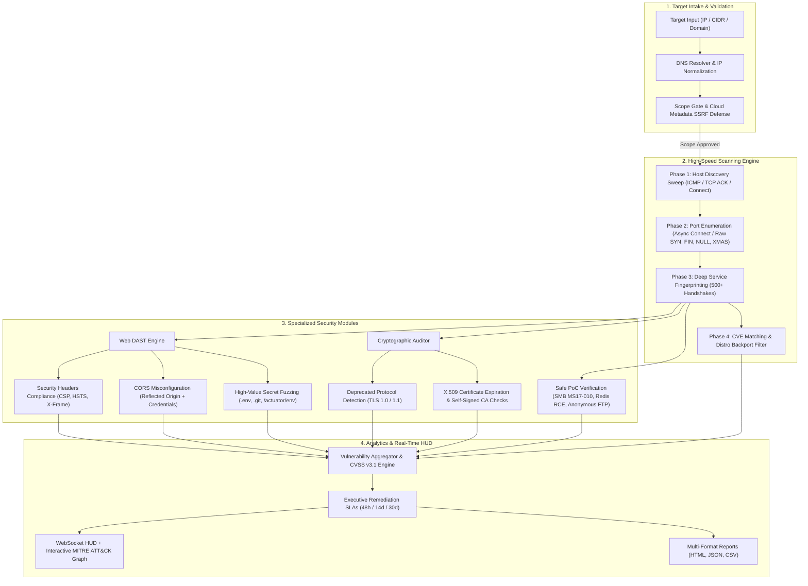

# ⬡ PENTRAX v10.0
### **ENTERPRISE WEB VULNERABILITY ASSESSMENT & OFFENSIVE AUDIT PLATFORM**

[](https://www.python.org/)
[](LICENSE)
[]()
[](https://github.com/yerondereje432/yerscan/actions/workflows/ci.yml)
[]()

> **PENTRAX** is a next-generation, high-concurrency vulnerability assessment platform engineered for cybersecurity researchers, penetration testers, and DevSecOps professionals. It bridges the gap between low-level network discovery, deep web application DAST (Dynamic Application Security Testing), SSL/TLS cryptographic auditing, and threat-actor intelligence mapping in a unified, modern web operations console.

---

## 📑 Table of Contents
1. [Purpose of the Project](#-purpose-of-the-project)
2. [How the Project Works](#-how-the-project-works)
   - [System Architecture](#system-architecture)
   - [Execution Lifecycle & Scanning Phases](#execution-lifecycle--scanning-phases)
   - [Core Technical Innovations](#core-technical-innovations)
3. [How Hackers & Penetration Testers Use It](#-how-hackers--penetration-testers-use-it)
   - [Reconnaissance & Asset Discovery](#1-reconnaissance--perimeter-mapping)
   - [Firewall & IDS Evasion Tactics](#2-firewall--ids-evasion-tactics)
   - [Web Application Exploitation & DAST Fuzzing](#3-web-application-dast--secret-discovery)
   - [Cryptographic Weakness Identification](#4-cryptographic-weakness-identification)
   - [MITRE ATT&CK Threat Path Simulation](#5-mitre-attck-threat-actor-attribution)
   - [Executive Remediation & SLA Governance](#6-executive-remediation--sla-governance)
4. [Quick Start & Setup](#-quick-start--setup)
   - [Web Console Operations](#web-console-operations-recommended)
   - [Command-Line Interface (CLI)](#cli-operations)
5. [Privilege Modes: Unprivileged vs. Root](#-privilege-modes-unprivileged-vs-root)
6. [CLI Command Reference & Presets](#-cli-command-reference--presets)
7. [Verification & Test Suite](#-verification--test-suite)
8. [Ethical Rules of Engagement & Disclaimer](#-ethical-rules-of-engagement--legal-disclaimer)

---

## 🎯 Purpose of the Project

In enterprise cybersecurity, security teams frequently encounter a fragmented toolchain:
- Network scanners (e.g., standard Nmap) identify open ports but lack native Web DAST, CORS inspection, and credential leak fuzzing.
- Web scanners (e.g., Nikto, OWASP ZAP) require pre-discovered URLs and do not perform low-level TCP flag manipulation or network topology analysis.
- Vulnerability scanners generate high volumes of false positives due to raw version string matching without understanding OS package backports.

**PENTRAX solves these challenges by providing:**
1. **Unified Offensive Pipeline**: Automatically resolves hostnames, identifies live hosts, probes ports across 7 scanning techniques, audits HTTP security headers and CORS configurations, hunts for exposed secrets (`.env`, `.git`), analyzes SSL/TLS ciphers, and cross-references CVEs.
2. **Defensive False-Positive Suppression**: Detects Linux distribution backport tags (`+deb`, `ubuntu`, `.el8`, `debian`) to prevent misleading alerts on security-patched enterprise kernels and servers.
3. **Scanner Self-Defense (SSRF Hardening)**: Protects the scanner and its web engine from being abused as a Server-Side Request Forgery proxy by enforcing strict link-local cloud metadata IP filtering (`169.254.169.254` and `fd00:ec2::254`).
4. **Actionable Remediation SLAs**: Automatically categorizes findings according to standard cybersecurity incident response timeframes (48 Hours for Critical, 14 Days for High, 30 Days for Medium).
5. **Academic & Practical Excellence**: Built as an Ethical Hacking capstone and defense tool designed for live demonstrations, security operations center (SOC) simulation, and penetration testing assessments.

---

## ⚙️ How the Project Works

### System Architecture



---

### Execution Lifecycle & Scanning Phases

When PENTRAX launches an assessment, it executes a deterministic, 6-phase security pipeline:

1. **Phase 1: Target Resolution & Scope Authorization Gate**
   - Automatically resolves target domains (e.g., `example.com` $\rightarrow$ `93.184.215.14`) via DNS.
   - Evaluates the IP against the **SSRF Cloud Metadata Filter**: if the target attempts to probe AWS, GCP, Azure, or OpenStack metadata services (`169.254.169.254` or `fd00:ec2::254`), the scan immediately aborts with an audit warning.
   - Verifies target authorization rules (fails closed if non-private scopes are queried without `--authorize`).

2. **Phase 2: High-Concurrency Port Discovery**
   - Dispatches thousands of non-blocking TCP socket probes concurrently using an adaptive asyncio event loop or raw socket injectors.
   - Applies evasion flags if requested: packet fragmentation (MTU 24/48), random decoy IP spoofing, and randomized probe intervals.

3. **Phase 3: Protocol Fingerprinting & Service Detection**
   - Sends customized protocol handshakes across discovered open ports (HTTP, SSH, FTP, SMTP, MySQL, Redis, MongoDB, Elasticsearch, Docker, Memcached, etc.).
   - Matches banners against an embedded database of 500+ application signatures.

4. **Phase 4: Web DAST & Cryptographic Auditing**
   - **Security Headers**: Inspects response headers for `Content-Security-Policy`, `Strict-Transport-Security`, `X-Frame-Options`, and `X-Content-Type-Options`.
   - **CORS Analysis**: Issues cross-origin requests with `Origin: https://pentrax-attacker-audit.com` to uncover origin reflection with `Access-Control-Allow-Credentials: true`.
   - **Secret Discovery**: Probes high-risk paths (`/.env`, `/.git/config`, `/actuator/env`, `/swagger-ui.html`, `/phpinfo.php`) and confirms exposures with signature regexes.
   - **SSL/TLS Audit**: Negotiates TLS handshakes to detect obsolete TLS 1.0/1.1 protocols, expired certificates, and untrusted/self-signed root chains.

5. **Phase 5: CVE Matching & Distribution Backport Filter**
   - Compares parsed service versions against the CVE database.
   - Evaluates whether the application banner includes Linux distribution package markers (e.g., `+deb9u7`, `ubuntu`, `.el8`). If detected, confidence is downgraded and vendor backport notices are attached to prevent false positives.
   - Runs safe, non-destructive Proof-of-Concept (PoC) verifications for critical flaws (e.g., MS17-010 SMB negotiation, Redis unauthenticated command execution).

6. **Phase 6: MITRE ATT&CK Graph Generation & SLA Assignment**
   - Synthesizes findings into active attack chains: `Target Host` $\rightarrow$ `Service` $\rightarrow$ `CVE` $\rightarrow$ `MITRE Technique (e.g., T1190)` $\rightarrow$ `Threat Actor (e.g., APT28, Lazarus)`.
   - Embeds Executive Remediation SLAs and streams updates in real-time over WebSockets to the web dashboard.

---

## 🥷 How Hackers & Penetration Testers Use It

Security practitioners and red-team operators utilize PENTRAX across every stage of the penetration testing methodology:

### 1. Reconnaissance & Perimeter Mapping
- **Objective**: Identify public-facing attack surfaces without triggering immediate detection.
- **Workflow**:
  ```bash
  # Fast, unprivileged discovery across a target subnet
  python3 pentrax.py target-domain.com -p top100 --fast
  ```
- **Hacker Perspective**: By querying the top 100 ports using asynchronous TCP Connect scans, an auditor quickly establishes the active service footprint (web applications, reverse proxies, exposed databases) in seconds.

### 2. Firewall & IDS Evasion Tactics
- **Objective**: Bypass stateful inspection firewalls, packet filters, and rate-limiting IDSes.
- **Workflow**:
  ```bash
  # Stealth SYN scan with packet fragmentation, decoy IPs, and paranoid timing
  sudo python3 pentrax.py 192.168.1.50 -s syn --mtu 24 --decoy RND,RND,192.168.1.1 --timing T1 --shuffle
  ```
- **Hacker Perspective**:
  - `--mtu 24` fragments TCP packets into tiny 8-byte chunks, preventing naive signature firewalls from reconstructing the TCP header.
  - `--decoy RND` floods the target's intrusion detection system with packets from random spoofed IP addresses, concealing the tester's true origin.
  - `--timing T1` spaces out probes to defeat threshold-based anomaly detection.

### 3. Web Application DAST & Secret Discovery
- **Objective**: Find critical web application vulnerabilities and exposed credentials without needing credentials.
- **Workflow**:
  - Run with `--dast` (enabled by default) or toggle **Web DAST Assessment** in the Web UI.
- **Hacker Perspective**:
  - If a developer accidentally left `/.env` accessible, PENTRAX retrieves the file, matches variables like `DB_PASSWORD` or `AWS_ACCESS_KEY`, and immediately generates a **CRITICAL (48-Hour SLA)** vulnerability card with captured evidence.
  - If an API reflects arbitrary `Origin` headers while setting `Access-Control-Allow-Credentials: true`, an ethical hacker can craft a Cross-Origin exploit to steal session cookies.

### 4. Cryptographic Weakness Identification
- **Objective**: Detect man-in-the-middle vectors and compliance failures.
- **Workflow**:
  - Automated during port 443 / 8443 scanning or via `--ssl-audit`.
- **Hacker Perspective**:
  - Identifies servers still negotiating TLS 1.0 or TLS 1.1, which are susceptible to cipher downgrade attacks (POODLE, BEAST).
  - Flags expired or self-signed certificates that could trick users or indicate forgotten staging servers.

### 5. MITRE ATT&CK Threat Actor Attribution
- **Objective**: Translate raw port and service findings into adversarial threat intelligence for executive debriefs.
- **Workflow**:
  - View the **MITRE ATT&CK Graph Visualizer** in the web interface.
- **Hacker Perspective**:
  - Seeing that an exposed SMB service matches CVE-2017-010 immediately links the vulnerability to **MITRE Technique T1210 (Exploitation of Remote Services)** and campaigns utilized by threat actors like **Lazarus Group** and **Sandworm**.

### 6. Executive Remediation & SLA Governance
- **Objective**: Deliver a comprehensive report to engineering teams with clear remediation deadlines.
- **Workflow**:
  - Click **Export Report** $\rightarrow$ **HTML** or **CSV** in the web dashboard.
- **Hacker Perspective**:
  - Reports categorize findings by severity and include exact remediation instructions (e.g., adding `Content-Security-Policy: default-src 'self'`) along with contract-grade SLAs.

---

## 🚀 Quick Start & Setup

### Prerequisites
- **Python**: Version 3.11 or higher (required by the Starlette web engine).
- **Dependencies**: None for the core CLI (uses pure Python standard library!).
- **Web Console**: Requires `starlette`, `uvicorn`, and `PyYAML` (installable via `pip install -r requirements.txt`).

```bash
# Clone the repository
git clone https://github.com/yerondereje432/yerscan.git
cd yerscan

# Make launcher executable
chmod +x run_server.py pentrax.py yerscan.py
```

---

### Web Console Operations (Recommended)

Start the PENTRAX Cyber Operations Console:

```bash
# Unprivileged Mode (Safe TCP Connect Engine)
python3 run_server.py --host 127.0.0.1 --port 8080

# Or Elevated Mode (Unlocks Stealth SYN / ACK / FIN / XMAS Scans)
sudo python3 run_server.py --host 127.0.0.1 --port 8080
```

> [!NOTE]
> **Default Credentials (first launch only)**: a fresh database seeds three demo accounts — `admin` / `pentrax1337` (admin), `yohannes` / `pentrax1337` (admin), and `operator` / `operator123` (operator). Set the `PENTRAX_ADMIN_PASSWORD` environment variable **before first launch** to override the admin passwords (see `docker-compose.yml`). Delete `pentrax.db` and restart to re-seed. Change these on any real deployment.

1. Open your browser and navigate to **`http://127.0.0.1:8080`**.
2. Click **New Assessment** in the upper-right corner.
3. Enter your target IP, subnet (e.g., `192.168.1.0/24`), or domain (e.g., `example.com`).
4. Select your desired intelligence modules:
   - `[✓] Deep Intel Probes (15+ Services)`
   - `[✓] Web DAST (CORS, Headers, Secrets)`
   - `[✓] SSL/TLS Cryptographic Audit`
   - `[✓] Safe PoC Verification Checks`
5. Acknowledge the Ethical Rules of Engagement and click **Launch Assessment**.
6. Monitor live discovery on the interactive WebSocket HUD and inspect attack chains on the **MITRE ATT&CK Graph**.

---

### CLI Operations

```bash
# Verify system readiness and run built-in diagnostics
python3 pentrax.py --self-test

# Scan a single host (Top 100 ports, fast mode)
python3 pentrax.py 127.0.0.1 --fast

# Deep audit of a web application with full reporting
python3 pentrax.py target.com -p 80,443,8080,8443 --deep --format all
```

---

## 🔒 Privilege Modes: Unprivileged vs. Root

PENTRAX automatically adapts its operational behavior depending on your operating system privileges:

| Capability | Unprivileged User (Standard) | Root / Elevated (`sudo`) |
| :--- | :---: | :---: |
| **TCP Connect Scanning** | ✅ Supported (Async socket engine) | ✅ Supported |
| **Web DAST & CORS Auditing** | ✅ Full Support | ✅ Full Support |
| **SSL/TLS Cryptographic Audit** | ✅ Full Support | ✅ Full Support |
| **CVE Matching & Distro Backports** | ✅ Full Support | ✅ Full Support |
| **MITRE ATT&CK Graph & Reports** | ✅ Full Support | ✅ Full Support |
| **SYN Stealth Scanning** | ❌ Requires Raw Sockets | ✅ Full Support |
| **ACK / FIN / NULL / XMAS Probes** | ❌ Requires Raw Sockets | ✅ Full Support |
| **TCP Window Scanning** | ❌ Requires Raw Sockets | ✅ Full Support |
| **Packet Fragmentation & Decoys** | ❌ Requires Raw Sockets | ✅ Full Support |
| **OS Fingerprinting via IP TTL** | ⚠️ Fallback estimation | ✅ High-accuracy raw inspection |

---

## 📖 CLI Command Reference & Presets

### Scanning Presets
- `--quick`: Scans the top 50 ports with high concurrency (fast recon).
- `--fast`: Scans the top 100 ports with a 0.5s connection timeout.
- `--stealth`: Activates SYN scan, packet shuffling, evasive delays, and T2 timing.
- `--thorough`: Scans all 65,535 TCP ports, UDP services, and runs deep intel probes.
- `--full`: Complete assessment including all ports, UDP, deep intel, and ICMP discovery sweeps.

### Timing Templates
- `-T0 (Paranoid)`: Serial, extreme delay (evades strict IDS/IPS).
- `-T1 (Sneaky)`: Slow random delay (evades heuristic detection).
- `-T2 (Polite)`: Rate-limited scanning (reduces target load).
- `-T3 (Normal)`: Default adaptive timing.
- `-T4 (Aggressive)`: Fast parallel scanning suited for test environments.
- `-T5 (Insane)`: Maximum socket throughput (high-bandwidth lab networks).

### Common Command Examples

```bash
# Scan a CIDR block with HTML report export
python3 pentrax.py 192.168.1.0/24 -p top50 -f html -o lab_report

# Stealth scan with randomized decoys
sudo python3 pentrax.py 10.0.0.5 -s syn --decoy RND,RND --evasive

# Specific service scan excluding an administrative IP
python3 pentrax.py 10.0.0.0/24 -p 22,80,443,3306 --exclude 10.0.0.1
```

---

## 🧪 Verification & Test Suite

PENTRAX includes a comprehensive unit and integration test suite with **87 automated tests** covering core network engines, packet reassembly, DAST fuzzing, SSL handshake parsing, and SSRF defenses:

```bash
# Install runtime dependencies plus httpx2 (test-only HTTP client required by the web API tests)
pip install -r requirements.txt httpx2

# Run complete test suite
python3 -m unittest discover -s tests -v
```

```text
test_audit_web_dast_logic (test_web_api.TestWebAPI) ... ok
test_cloud_metadata_ssrf_blocked (test_pentrax.TestScopeGate) ... ok
test_start_scan_validation_fails_on_cloud_metadata_ip (test_web_api.TestWebAPI) ... ok
test_backport_detection_and_sla (test_pentrax.TestCVEMatching) ... ok
test_vulnerability_sla_auto_assignment (test_web_api.TestWebAPI) ... ok
test_export_scan_formats (test_web_api.TestWebAPI) ... ok
test_websocket_sync (test_web_api.TestWebAPI) ... ok
...
----------------------------------------------------------------------
Ran 87 tests in 12.9s

OK (skipped=4)
```

---

## ⚖️ Ethical Rules of Engagement & Legal Disclaimer

> [!IMPORTANT]
> **READ CAREFULLY BEFORE USE**:
> PENTRAX is designed exclusively for authorized penetration testing, security research, vulnerability assessment, and educational evaluations.
>
> 1. **Explicit Written Authorization**: Never execute assessments against networks, IP addresses, domains, or web applications without prior written consent from the target system owner.
> 2. **Compliance with Legal Statutes**: Scanning unauthorized systems may violate laws including the United States Computer Fraud and Abuse Act (CFAA), the UK Computer Misuse Act, and international computer crime regulations.
> 3. **Non-Destructive Execution**: PENTRAX utilizes safe, non-destructive validation probes. Do not modify the source code to perform denial-of-service (DoS) or destructive exploitation.
> 4. **Liability Disclaimer**: The authors and contributors assume no liability for misuse or damage caused by this software. Use responsibly and ethically.

---

## 👥 Project Team & Authors (INSA Cyber Talent Center)

This project is developed as a Capstone Final Year Project by the Cybersecurity Engineering Team at the **Information Network Security Administration (INSA) – Cyber Talent Center (CTC)**:

| Name | Student ID | Specialization / Role |
| :--- | :--- | :--- |
| **Yohannes Garomsa** | `CTC-1368-26` | Core Architecture & Network Reconnaissance |
| **Yeron Dereje** | `CTC-1355-26` | Project Lead & Full-Stack Security Engineering |
| **Leyou Tesfahun** | `CTC-1975-26` | Web DAST Engine & Parameter Fuzzing Oracles |
| **Idris Elmi** | `CTC-424-26` | Threat Intelligence, CVE Feeds & TLS Auditing |
| **Cipara Yohannes** | `CTC-7659-26` | Declarative YAML Templates & Verification Suite |

---

<div align="center">
  <sub>PENTRAX v10.0 • Developed at INSA Cyber Talent Center (CTC) • MIT License</sub>
</div>
