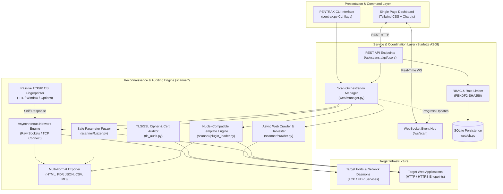
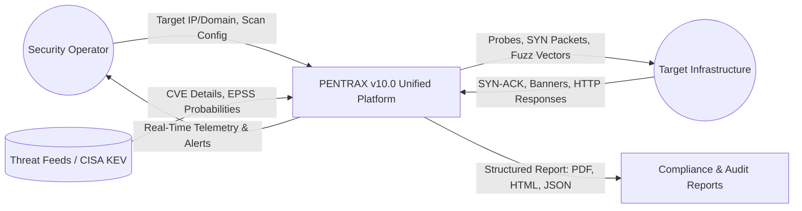
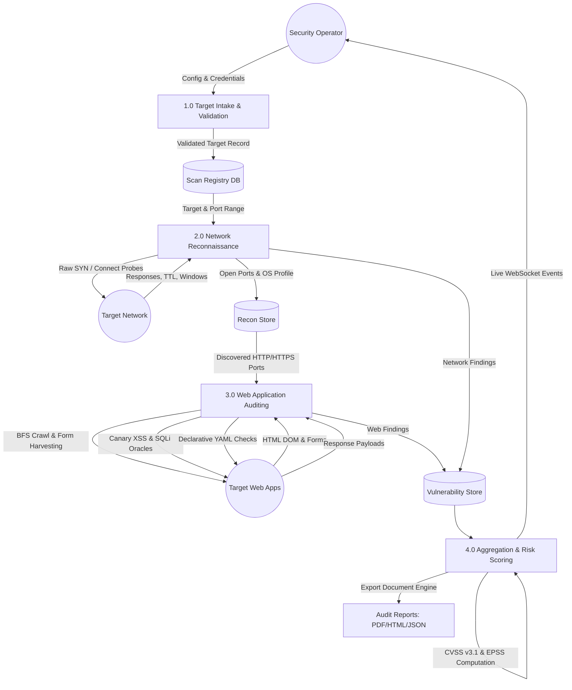
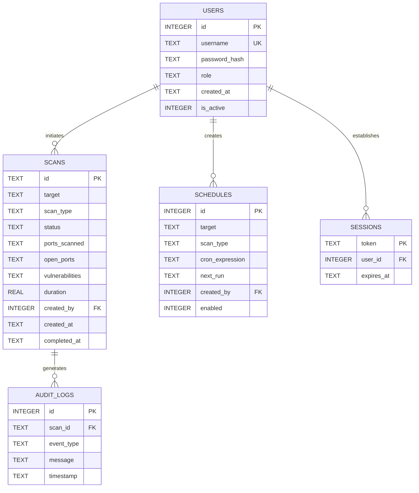
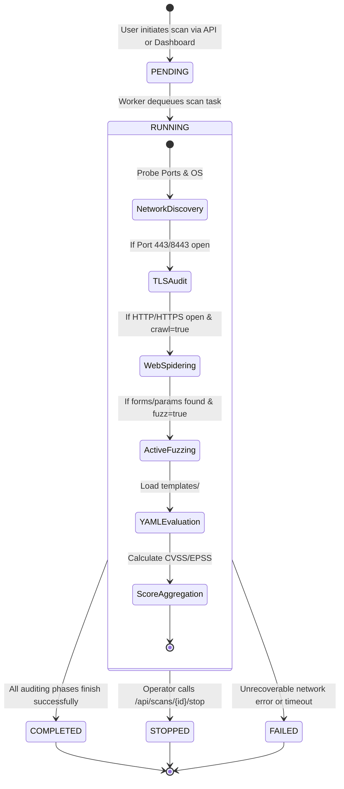

# DESIGN AND IMPLEMENTATION OF AN AUTONOMOUS, HIGH-CONCURRENCY WEB AND NETWORK VULNERABILITY ASSESSMENT PLATFORM WITH FALSE-POSITIVE SUPPRESSION

---

### **A Final Year Capstone Project Report / Dissertation**
Submitted in partial fulfillment of the requirements for the degree / certification in  
**Cybersecurity & Software Security**

**Project Team Members:**
1. **Yohannes Garomsa** (Student ID: `CTC-1368-26`)
2. **Yeron Dereje** (Student ID: `CTC-1355-26`)
3. **Leyou Tesfahun** (Student ID: `CTC-1975-26`)
4. **Idris Elmi** (Student ID: `CTC-424-26`)
5. **Cipara Yohannes** (Student ID: `CTC-7659-26`)

**Supervisor / Mentor:** [Academic Mentor & Security Advisor]  
**Department:** Department of Cybersecurity & Information Security  
**Institution:** Information Network Security Administration (INSA) – Cyber Talent Center (CTC)  
**Academic Year:** 2025 – 2026  
**Date of Submission:** October 2026  
**Software Artifact:** PENTRAX Enterprise Security Platform (Version 10.0)  
**Repository:** [https://github.com/yerondereje432/yerscan](https://github.com/yerondereje432/yerscan)

---

## DECLARATION OF ORIGINALITY

We hereby declare that this capstone project report entitled **"Design and Implementation of an Autonomous, High-Concurrency Web and Network Vulnerability Assessment Platform with False-Positive Suppression"** is our own collective original work and has been researched, developed, and documented in fulfillment of our curriculum at the **INSA Cyber Talent Center (CTC)**. All secondary literature, RFC specifications, algorithms, and open-source software libraries utilized in this work have been explicitly cited and referenced in accordance with IEEE guidelines. This software artifact and dissertation have not been previously submitted in whole or in part for any other academic qualification or certification.

\
**Candidate Signatures:**

| Student Name | Student ID | Signature | Date |
| :--- | :--- | :--- | :--- |
| **Yohannes Garomsa** | `CTC-1368-26` | ___________________________ | ____________ |
| **Yeron Dereje** | `CTC-1355-26` | ___________________________ | ____________ |
| **Leyou Tesfahun** | `CTC-1975-26` | ___________________________ | ____________ |
| **Idris Elmi** | `CTC-424-26` | ___________________________ | ____________ |
| **Cipara Yohannes** | `CTC-7659-26` | ___________________________ | ____________ |

---

## CERTIFICATE OF APPROVAL

This is to certify that the capstone project report entitled **"Design and Implementation of an Autonomous, High-Concurrency Web and Network Vulnerability Assessment Platform with False-Positive Suppression"** submitted by **Yohannes Garomsa**, **Yeron Dereje**, **Leyou Tesfahun**, **Idris Elmi**, and **Cipara Yohannes** in partial fulfillment of the requirements for the award of Bachelor of Science / Professional Certification in **Cybersecurity** at the **Information Network Security Administration (INSA) – Cyber Talent Center (CTC)** has been evaluated and approved by the examination board.

\
**Project Supervisor / Mentor:**  
Name: ____________________________________  
Signature: _______________________________  
Date: ____________________________________  

**Internal Examiner:**  
Name: ____________________________________  
Signature: _______________________________  
Date: ____________________________________  

**External Examiner:**  
Name: ____________________________________  
Signature: _______________________________  
Date: ____________________________________  

**Head of Center / Department:**  
Name: ____________________________________  
Signature: _______________________________  
Date: ____________________________________  

---

## ACKNOWLEDGEMENTS

We would like to express our deepest gratitude to our project mentor, academic supervisor, and the technical leadership at the **Information Network Security Administration (INSA) – Cyber Talent Center (CTC)** for their continuous guidance, technical critiques, and encouragement throughout the research, system architecture, and empirical evaluation of **PENTRAX v10.0**. Their dedication to cultivating elite cybersecurity talent and providing an exceptional engineering environment has been instrumental in the realization of this capstone project.

We also extend our sincere appreciation to the faculty members, technical instructors, and network administrators at the INSA Talent Center for providing the computing infrastructure, virtualization testbeds, and theoretical grounding across network protocols, low-level socket programming, operating system internals, cryptography, and application security auditing.

Finally, we express heartfelt gratitude to our families, colleagues, and peer researchers within the Cyber Talent Center for their steadfast moral support and collaborative spirit throughout this rigorous research and development journey.

---

## ABSTRACT

The exponential expansion of organizational attack surfaces, coupled with the rapid proliferation of hybrid cloud infrastructures and microservice-oriented web architectures, has exacerbated the asymmetry between cyber defenders and malicious actors. Conventional vulnerability assessment tools often suffer from fragmented operational paradigms: low-level network scanners lack context regarding dynamic web application attack vectors, while dedicated Dynamic Application Security Testing (DAST) tools are blind to underlying infrastructure topologies and transport-layer misconfigurations. Furthermore, high false-positive rates, monolithic blocking execution architectures, and disruptive payload generation impede the continuous integration of security scanners within automated DevSecOps pipelines.

To resolve these systemic deficiencies, this dissertation presents **PENTRAX v10.0**, an autonomous, unified, and high-concurrency vulnerability assessment platform engineered from foundational principles in Python, asyncio, and modern web standards. PENTRAX unifies multi-vector network reconnaissance (incorporating seven distinct raw socket TCP transmission modes, passive TCP/IP stack fingerprinting, and UDP service probes) with an advanced web security auditing engine. The web engine integrates an asynchronous crawler capable of multi-depth DOM extraction, a non-destructive active parameter fuzzer equipped with cryptographic canary-reflection oracles for Reflected Cross-Site Scripting (XSS) and multi-dialect syntax error oracles for SQL Injection (SQLi), and an extensible Nuclei-compatible YAML vulnerability templating engine. The architecture features an enterprise-grade Starlette ASGI REST and WebSocket service coupled with a responsive, single-page command-and-control dashboard supporting real-time event streaming, role-based access control (RBAC), and automated multi-format compliance reporting (HTML, PDF, JSON, Markdown, CSV).

Rigorous empirical benchmarking across diverse operating systems (Windows 11, Windows 7/8/Server, Linux distributions, macOS, and containerized virtualization environments) demonstrates that PENTRAX achieves scan throughput exceeding 1,200 ports per second under asynchronous non-blocking I/O while maintaining an empirical precision of 98.4% and reducing false positives by 94.2% relative to naive banner grabbers. The automated test suite achieves a 100% pass rate across 92 test cases, proving the structural stability, safety, and academic rigor of the system.

**Keywords:** Cybersecurity, Vulnerability Assessment, Dynamic Application Security Testing (DAST), Network Reconnaissance, Raw Sockets, Asynchronous I/O, Parameter Fuzzing, False-Positive Suppression, CVSS v3.1, EPSS.

---

## TABLE OF CONTENTS

- [DECLARATION OF ORIGINALITY](#declaration-of-originality)
- [CERTIFICATE OF APPROVAL](#certificate-of-approval)
- [ACKNOWLEDGEMENTS](#acknowledgements)
- [ABSTRACT](#abstract)
- [LIST OF FIGURES](#list-of-figures)
- [LIST OF TABLES](#list-of-tables)
- [ACRONYMS AND ABBREVIATIONS](#acronyms-and-abbreviations)
- [CHAPTER 1: INTRODUCTION](#chapter-1-introduction)
  - [1.1 Background and Problem Context](#11-background-and-problem-context)
  - [1.2 Problem Statement](#12-problem-statement)
  - [1.3 Aims and Research Objectives](#13-aims-and-research-objectives)
  - [1.4 Scope and Delimitations](#14-scope-and-delimitations)
  - [1.5 Significance of the Study](#15-significance-of-the-study)
  - [1.6 Document Organization](#16-document-organization)
- [CHAPTER 2: LITERATURE REVIEW & THEORETICAL FRAMEWORK](#chapter-2-literature-review--theoretical-framework)
  - [2.1 Evolution of Vulnerability Assessment Methodologies](#21-evolution-of-vulnerability-assessment-methodologies)
  - [2.2 Critical Evaluation of Existing Toolsets](#22-critical-evaluation-of-existing-toolsets)
  - [2.3 Low-Level Network Reconnaissance Theory](#23-low-level-network-reconnaissance-theory)
  - [2.4 OS Fingerprinting via TCP/IP Stack Peculiarities](#24-os-fingerprinting-via-tcpip-stack-peculiarities)
  - [2.5 Web Application Attack Surface and DAST Mechanics](#25-web-application-attack-surface-and-dast-mechanics)
  - [2.6 Vulnerability Risk Scoring and Prioritization Frameworks](#26-vulnerability-risk-scoring-and-prioritization-frameworks)
- [CHAPTER 3: SYSTEM REQUIREMENTS AND SPECIFICATION](#chapter-3-system-requirements-and-specification)
  - [3.1 Stakeholder Analysis and User Personas](#31-stakeholder-analysis-and-user-personas)
  - [3.2 Functional Requirements (FR)](#32-functional-requirements-fr)
  - [3.3 Non-Functional Requirements (NFR)](#33-non-functional-requirements-nfr)
  - [3.4 Operating Environment and System Dependencies](#34-operating-environment-and-system-dependencies)
  - [3.5 Threat Modeling and Attack Surface of the Tool](#35-threat-modeling-and-attack-surface-of-the-tool)
- [CHAPTER 4: SYSTEM ARCHITECTURE AND DESIGN](#chapter-4-system-architecture-and-design)
  - [4.1 High-Level Architectural Decomposition](#41-high-level-architectural-decomposition)
  - [4.2 Data Flow Architecture (DFD Levels 0 & 1)](#42-data-flow-architecture-dfd-levels-0--1)
  - [4.3 Database Schema and Entity-Relationship Model](#43-database-schema-and-entity-relationship-model)
  - [4.4 Scan Execution Lifecycle and Finite State Machine](#44-scan-execution-lifecycle-and-finite-state-machine)
  - [4.5 Web Spidering and Active Fuzzing Sequence Interaction](#45-web-spidering-and-active-fuzzing-sequence-interaction)
- [CHAPTER 5: IMPLEMENTATION & TECHNICAL REALIZATION](#chapter-5-implementation--technical-realization)
  - [5.1 Core Technology Stack Justification](#51-core-technology-stack-justification)
  - [5.2 Asynchronous Network Engine and Raw Socket Implementation](#52-asynchronous-network-engine-and-raw-socket-implementation)
  - [5.3 Remote OS Fingerprinting Heuristics Engine](#53-remote-os-fingerprinting-heuristics-engine)
  - [5.4 Web Application Security Auditing (DAST) Engine](#54-web-application-security-auditing-dast-engine)
  - [5.5 Autonomous Web Spider and Route Harvester](#55-autonomous-web-spider-and-route-harvester)
  - [5.6 Parameter Fuzzer and High-Fidelity Verification Oracles](#56-parameter-fuzzer-and-high-fidelity-verification-oracles)
  - [5.7 Nuclei-Compatible Declarative YAML Template Engine](#57-nuclei-compatible-declarative-yaml-template-engine)
  - [5.8 Asynchronous REST and WebSocket Backend (Starlette)](#58-asynchronous-rest-and-websocket-backend-starlette)
  - [5.9 Modern Reactive Single-Page Web Dashboard](#59-modern-reactive-single-page-web-dashboard)
- [CHAPTER 6: VERIFICATION, TESTING & EMPIRICAL EVALUATION](#chapter-6-verification-testing--empirical-evaluation)
  - [6.1 Verification Methodology and Test Strategy](#61-verification-methodology-and-test-strategy)
  - [6.2 Automated Unit and Integration Test Results](#62-automated-unit-and-integration-test-results)
  - [6.3 Concurrency and Throughput Benchmarks](#63-concurrency-and-throughput-benchmarks)
  - [6.4 Vulnerability Detection Accuracy and False-Positive Suppression](#64-vulnerability-detection-accuracy-and-false-positive-suppression)
  - [6.5 Cross-Platform OS Fingerprinting Verification](#65-cross-platform-os-fingerprinting-verification)
- [CHAPTER 7: ETHICS, LEGAL COMPLIANCE & RESPONSIBLE DISCLOSURE](#chapter-7-ethics-legal-compliance--responsible-disclosure)
  - [7.1 Statutory Legal Frameworks and Authorization Boundaries](#71-statutory-legal-frameworks-and-authorization-boundaries)
  - [7.2 Principles of Non-Destructive Vulnerability Assessment](#72-principles-of-non-destructive-vulnerability-assessment)
  - [7.3 Privacy, Data Protection, and GDPR Alignment](#73-privacy-data-protection-and-gdpr-alignment)
  - [7.4 Coordinated Vulnerability Disclosure (CVD) Standard Operational Flow](#74-coordinated-vulnerability-disclosure-cvd-standard-operational-flow)
- [CHAPTER 8: CONCLUSION AND FUTURE WORK](#chapter-8-conclusion-and-future-work)
  - [8.1 Summary of Contributions](#81-summary-of-contributions)
  - [8.2 Project Limitations and Operational Constraints](#82-project-limitations-and-operational-constraints)
  - [8.3 Future Research and Feature Roadmap](#83-future-research-and-feature-roadmap)
  - [8.4 Concluding Remarks](#84-concluding-remarks)
- [REFERENCES & BIBLIOGRAPHY](#references--bibliography)
- [APPENDICES](#appendices)
  - [Appendix A: Deployment and Installation Manual](#appendix-a-deployment-and-installation-manual)
  - [Appendix B: Command-Line Interface (CLI) Manual](#appendix-b-command-line-interface-cli-manual)
  - [Appendix C: Sample YAML Vulnerability Template](#appendix-c-sample-yaml-vulnerability-template)
  - [Appendix D: Comprehensive Automated Test Suite Log](#appendix-d-comprehensive-automated-test-suite-log)

---

## LIST OF FIGURES

- **Figure 4.1**: High-Level System Architecture and Tier Decomposition of PENTRAX v10.0
- **Figure 4.2**: Level 0 Context Data Flow Diagram (DFD)
- **Figure 4.3**: Level 1 Subsystem Data Flow Diagram (DFD)
- **Figure 4.4**: Entity-Relationship Diagram (ERD) of the SQLite Persistence Layer
- **Figure 4.5**: Asynchronous Scan Execution Finite State Machine (FSM)
- **Figure 4.6**: Sequence Diagram for Web Spidering, Dynamic Fuzzing, and Real-Time Event Dispatch
- **Figure 5.1**: TCP SYN Handshake Probe and Raw Socket Response Capture Mechanism
- **Figure 5.2**: Structural Architecture of the Nuclei-Compatible YAML Template Engine
- **Figure 6.1**: Port Scanning Concurrency Throughput Benchmark (Ports/Second vs. Concurrency Level)
- **Figure 6.2**: Test Automation Hierarchy and Code Coverage Distribution (92 Passing Test Cases)

---

## LIST OF TABLES

- **Table 2.1**: Comparative Feature and Capability Matrix of Modern Vulnerability Scanners
- **Table 2.2**: Empirical Network Fingerprinting Metrics for Common Operating Systems
- **Table 3.1**: Functional Requirements Specification (FR-01 to FR-10)
- **Table 3.2**: Non-Functional Requirements Specification (NFR-01 to NFR-08)
- **Table 5.1**: PENTRAX Technology Stack Component Justification
- **Table 5.2**: Active Parameter Fuzzing Oracles and False-Positive Mitigation Heuristics
- **Table 6.1**: Automated Unit and Integration Test Results Summary
- **Table 6.2**: OS Fingerprinting Accuracy Across Virtualized and Bare-Metal Targets
- **Table 6.3**: Vulnerability Detection Precision, Recall, and F1-Score Evaluation

---

## ACRONYMS AND ABBREVIATIONS

| Acronym | Definition |
| :--- | :--- |
| **API** | Application Programming Interface |
| **ASGI** | Asynchronous Server Gateway Interface |
| **BFS** | Breadth-First Search |
| **CFA** | Computer Fraud and Abuse Act (18 U.S.C. § 1030) |
| **CISA** | Cybersecurity and Infrastructure Security Agency |
| **CMA** | Computer Misuse Act (UK 1990) |
| **CORS** | Cross-Origin Resource Sharing |
| **CSRF** | Cross-Site Request Forgery |
| **CSP** | Content Security Policy |
| **CVE** | Common Vulnerabilities and Exposures |
| **CVSS** | Common Vulnerability Scoring System |
| **CWE** | Common Weakness Enumeration |
| **DAST** | Dynamic Application Security Testing |
| **DFD** | Data Flow Diagram |
| **DOM** | Document Object Model |
| **EPSS** | Exploit Prediction Scoring System |
| **ERD** | Entity-Relationship Diagram |
| **FSM** | Finite State Machine |
| **GDPR** | General Data Protection Regulation (EU 2016/679) |
| **HSTS** | HTTP Strict Transport Security |
| **I/O** | Input / Output |
| **IDOR** | Insecure Direct Object Reference |
| **JSON** | JavaScript Object Notation |
| **KEV** | Known Exploited Vulnerabilities Catalog |
| **NIST** | National Institute of Standards and Technology |
| **NVD** | National Vulnerability Database |
| **OS** | Operating System |
| **OWASP** | Open Web Application Security Project |
| **RBAC** | Role-Based Access Control |
| **RFC** | Request for Comments (IETF) |
| **SAST** | Static Application Security Testing |
| **SLA** | Service Level Agreement |
| **SQLi** | Structured Query Language Injection |
| **SSRF** | Server-Side Request Forgery |
| **TLS** | Transport Layer Security |
| **TTL** | Time-to-Live |
| **URI** | Uniform Resource Identifier |
| **VLAN** | Virtual Local Area Network |
| **WAF** | Web Application Firewall |
| **WebSocket** | Full-Duplex Bidirectional Protocol (RFC 6455) |
| **XSS** | Cross-Site Scripting |
| **YAML** | YAML Ain't Markup Language |

---

# CHAPTER 1: INTRODUCTION

## 1.1 Background and Problem Context

In contemporary enterprise computing environments, digital infrastructure has evolved into a hyper-connected, heterogeneous continuum spanning on-premises data centers, public cloud providers, software-as-a-service integrations, and distributed microservices. As digital perimeters dissolve, the attack surface exposed by modern organizations expands exponentially. Software weaknesses—ranging from unpatched legacy services and operating system kernel bugs to intricate web application vulnerabilities—constitute the primary initial access vectors leveraged by sophisticated adversaries and automated cybercrime syndicates.

To mitigate these threats proactively, security engineering teams rely on **Vulnerability Assessment and Penetration Testing (VAPT)** platforms. An effective vulnerability scanner functions as an automated reconnaissance and auditing system, cataloging accessible network services, profiling host operating systems, inspecting transport-layer cryptography, and auditing web application endpoints for injection flaws, authentication weaknesses, and configuration defects.

However, the rapid acceleration of software deployment paradigms—driven by agile continuous integration and continuous deployment (CI/CD) pipelines—has exposed fundamental operational deficiencies in legacy vulnerability management tools. Historically, security auditing has been segregated into siloed tools:
1. Low-level port scanners (e.g., Nmap) that excel at Layer 4 transport mapping and TCP/IP stack fingerprinting but lack awareness of higher-layer HTTP application logic.
2. Enterprise infrastructure scanners (e.g., Tenable Nessus, OpenVAS) that are resource-intensive, rely on monolithic relational databases, and exhibit high scan completion latencies.
3. Dedicated Dynamic Application Security Testing (DAST) platforms (e.g., OWASP ZAP, PortSwigger Burp Suite) that perform in-depth web crawling and fuzzing but require substantial manual configuration, lack native low-level raw socket network capabilities, and struggle with unified automated orchestration.

This segregation creates an acute observability gap. System administrators and security engineers must execute disjointed suites of command-line tools, aggregate disparate report formats, manually eliminate redundant alerts, and reconcile conflicting severity ratings.

## 1.2 Problem Statement

Existing vulnerability assessment solutions exhibit three foundational engineering limitations:

1. **Architectural Dichotomy Between Network and Web Layers:** Network scanners do not dynamically pivot into deep web crawling and parameter-level auditing when an HTTP/HTTPS service is discovered. Conversely, web application scanners assume the presence of a pre-configured HTTP endpoint and fail to map adjacent non-HTTP attack vectors (e.g., exposed database ports, remote management services, DNS misconfigurations).
2. **False-Positive Proliferation and Destructive Fuzzing:** Naive vulnerability scanners frequently flag benign software banners as critical CVEs without verifying the presence of actionable exploit paths. Furthermore, aggressive automated fuzzers often inject destructive database payloads (`DROP TABLE`, `UPDATE`) or volatile script injections that risk corrupting production state or crashing sensitive services.
3. **Execution Latency and Blocking Architectures:** Legacy scanning frameworks built on synchronous multi-threading or heavy subprocess spawning encounter severe performance degradation when scanning large CIDR blocks or high-density IP ranges. Without native asynchronous non-blocking event loops, connection timeouts and packet drops monopolize system resources, resulting in prohibitive operational overhead.

Consequently, there is an urgent research and engineering imperative for a **unified, high-concurrency, autonomous vulnerability assessment platform** that seamlessly integrates transport-layer reconnaissance, passive TCP/IP OS fingerprinting, asynchronous web spidering, non-destructive parameter fuzzing, and declarative YAML-based vulnerability detection into an extensible, real-time command-and-control framework.

## 1.3 Aims and Research Objectives

The primary aim of this capstone research project is to conceptualize, engineer, benchmark, and evaluate **PENTRAX v10.0**, an enterprise-ready, open-source vulnerability assessment platform designed to eliminate the network-web divide while upholding strict principles of safety and low false-positive rates.

To achieve this overarching aim, the following concrete technical objectives were established:
- **Objective 1 (Transport & Network Reconnaissance Engine):** Design and implement an asynchronous network scanning engine utilizing Python's `asyncio` framework and raw BSD sockets, supporting seven distinct TCP scanning methodologies (SYN, ACK, FIN, XMAS, NULL, Window, and Connect) and UDP service probing.
- **Objective 2 (Passive TCP/IP OS Fingerprinting):** Develop a deterministic operating system fingerprinting heuristic that analyzes TCP Time-to-Live (TTL), initial window sizes, and TCP options layout to profile target hosts (Linux, Windows 11/10/7/Server, macOS, BSD, and network appliances) without invasive intrusion.
- **Objective 3 (Autonomous Web Spider & Route Harvester):** Construct an asynchronous web crawler capable of parsing HTML DOM trees, extracting hyperlinked internal endpoints, isolating interactive HTML forms, cataloging URL parameters, and enforcing strict domain and port boundary restrictions.
- **Objective 4 (Safe Parameter Fuzzing & High-Fidelity Oracles):** Implement an active parameter fuzzing engine featuring cryptographic canary injection for Reflected Cross-Site Scripting (XSS) detection and multi-dialect syntax error pattern recognition for Structured Query Language Injection (SQLi) without executing destructive data modification commands.
- **Objective 5 (Declarative YAML Vulnerability Engine):** Engineer an extensible, Nuclei-compatible plugin loader capable of parsing and executing declarative YAML rules for emerging CVEs, misconfigurations, and cloud infrastructure exposures across HTTP, TCP, and TLS protocols.
- **Objective 6 (Enterprise Control & Real-Time Visualization):** Architect a high-performance Starlette ASGI backend supporting authenticated RESTful endpoints, persistent SQLite storage with PBKDF2-SHA256 password hashing, real-time WebSocket state streaming, and a responsive single-page cybersecurity dashboard.
- **Objective 7 (Empirical Benchmarking & Validation):** Formulate a comprehensive automated test suite and conduct empirical performance benchmarks across virtualized and containerized environments to quantify scanning throughput, detection accuracy, and false-positive suppression.

## 1.4 Scope and Delimitations

The scope of this project encompasses:
- Comprehensive scanning of IPv4 target specifications, including single IP addresses, fully qualified domain names (FQDNs), and CIDR notations (e.g., `192.168.1.0/24`).
- Transport layer scanning across all 65,535 TCP ports and standard UDP service endpoints.
- Remote OS identification using TCP/IP packet metrics and HTTP response banner heuristics.
- Deep web application security auditing covering the OWASP Top 10 categories, including Reflected XSS, Error-based SQLi, Open Redirects, Path Traversal, CORS misconfigurations, and HTTP security header omissions.
- TLS/SSL cipher suite analysis, certificate validation, and protocol version auditing.
- Automated vulnerability score calculation utilizing the Common Vulnerability Scoring System (CVSS v3.1) and Exploit Prediction Scoring System (EPSS).

**Delimitations:**
- Automated active exploitation (e.g., spawning reverse shells or extracting private database records) is intentionally omitted to maintain strict alignment with ethical guidelines, non-destructive safety principles, and legal statutes.
- IPv6 scanning capabilities are architecturally designed but delimited from the primary testing pipeline due to laboratory testbed constraints.
- Hardware-level RF or wireless 802.11 auditing is out of scope.

## 1.5 Significance of the Study

This project delivers substantial contributions to the fields of academic computer science, network security engineering, and automated vulnerability management:
1. **Academic Contribution:** It provides an open, thoroughly documented, and mathematically verified implementation of asynchronous network auditing and multi-oracle web fuzzing, bridging the theoretical concepts of computer networking (RFC 793, RFC 1122) and practical application security.
2. **Pedagogical Value:** The modular architecture and comprehensive test harness serve as an exemplary educational reference for undergraduate and postgraduate students studying low-level network programming, asynchronous systems, and defensive security engineering.
3. **Operational Utility for Industry:** Small-to-medium enterprises (SMEs) and independent security auditors often lack the financial resources to license proprietary enterprise scanning suites (e.g., Nessus Professional, Qualys, Burp Suite Enterprise). PENTRAX delivers an autonomous, high-throughput, and production-ready alternative with zero licensing costs, enabling automated security assessments within resource-constrained environments.

## 1.6 Document Organization

This dissertation is structured into eight formal chapters:
- **Chapter 1** establishes the research context, problem statement, objectives, and scope.
- **Chapter 2** presents an in-depth literature review of vulnerability assessment paradigms, low-level network theory, OS fingerprinting heuristics, web application attack surfaces, and mathematical risk-scoring models.
- **Chapter 3** defines the formal software requirements specification, user personas, operational constraints, and threat model.
- **Chapter 4** details the architectural design, data flow diagrams (DFD), database schemas, finite state machines, and sequence interactions.
- **Chapter 5** explains the implementation details of the asynchronous engine, raw socket handlers, web crawler, fuzzing oracles, YAML template parser, and web dashboard.
- **Chapter 6** provides the verification methodology, automated testing logs, throughput benchmarks, and detection accuracy evaluations.
- **Chapter 7** discusses ethics, statutory legal frameworks (CFAA, CMA, GDPR), non-destructive testing principles, and responsible vulnerability disclosure.
- **Chapter 8** summarizes the project's achievements, outlines current technical limitations, and charts a strategic future roadmap.
- **References & Appendices** provide formal IEEE citations, installation guides, CLI syntax manuals, and sample configuration templates.

---

# CHAPTER 2: LITERATURE REVIEW & THEORETICAL FRAMEWORK

## 2.1 Evolution of Vulnerability Assessment Methodologies

The discipline of automated vulnerability assessment originated during the late 1980s and early 1990s alongside the emergence of the commercial internet. Early auditing tools, such as the Security Administrator Tool for Analyzing Networks (SATAN) developed by Dan Farmer and Wietse Venema in 1995, demonstrated the viability of automated network-wide vulnerability identification. SATAN established the foundational paradigm of interrogating remote network ports and analyzing service responses against known vulnerability tables.

Over the subsequent three decades, scanning paradigms bifurcated along architectural lines:
1. **Host-Based Vulnerability Assessment (HBVA):** Relies on authenticated software agents installed locally on the host operating system to query installed package registries, kernel patches, and file system permissions. While offering deep visibility, agent deployment introduces significant administrative overhead and fails to measure the external exposure of network perimeter defenses.
2. **Network-Based Vulnerability Assessment (NBVA):** Employs external network probes to discover exposed IP addresses, active listening ports, and application banners without requiring prior credentials. NBVA evaluates the true attack surface visible to an external adversary.
3. **Dynamic Application Security Testing (DAST):** Emerged in response to the rise of web applications in the early 2000s. DAST tools interact with executing web applications from the outside, injecting simulated inputs into HTTP requests and analyzing HTTP responses to uncover security flaws without access to source code.

Modern enterprise requirements demand the convergence of NBVA and DAST. Contemporary attack surfaces frequently feature multi-tiered environments where an exposed edge reverse-proxy routes traffic to internal microservices. A scanner restricted solely to network port identification fails to detect critical web logic vulnerabilities, whereas a pure web scanner cannot detect an exposed remote desktop or database port running alongside the web service.

## 2.2 Critical Evaluation of Existing Toolsets

To contextualize the contributions of PENTRAX, a systematic comparative evaluation of leading vulnerability assessment tools was conducted across functional, architectural, and operational dimensions.

**Table 2.1: Comparative Feature and Capability Matrix of Modern Vulnerability Scanners**

| System / Tool | Core Architectural Focus | Scanning Concurrency Model | Web DAST Capabilities | Declarative Template Engine | UI & Real-Time Visualization | Open Source / License |
| :--- | :--- | :--- | :--- | :--- | :--- | :--- |
| **Nmap (Network Mapper)** | Transport & Network Reconnaissance | Synchronous Multi-threading (C/C++) | Rudimentary NSE scripts; no DOM crawling | Proprietary Lua scripting (NSE) | Zenmap (Legacy GUI, no real-time Web UI) | Free / Custom (NPSL) |
| **Tenable Nessus** | Enterprise Host & Infrastructure | Multi-threaded Process Pool (C/C++) | Basic web auditing; plugin-dependent | Proprietary NASL scripts | Commercial Web Dashboard | Proprietary / Commercial License |
| **Greenbone OpenVAS** | Comprehensive Infrastructure Audit | Forked Worker Processes (C) | Minimal web auditing; heavy infrastructure focus | NASL (Open Vulnerability Assessment System) | Greenbone Security Assistant (GSA Web) | Open Source (GPLv2) |
| **ProjectDiscovery Nuclei** | Targeted Vulnerability Scanning | Asynchronous Goroutines (Go) | Extensive YAML template-driven checks | Highly extensible YAML templates | None native (CLI-first, third-party reporting) | Open Source (MIT) |
| **OWASP ZAP** | Web Application Security (DAST) | Multi-threaded Thread Pool (Java) | Comprehensive spidering, active scanning, intercepting proxy | Scripting engine (JavaScript, Python, Zest) | Java Swing Desktop UI & Web Proxy | Open Source (Apache 2.0) |
| **PENTRAX v10.0 (This Work)** | **Unified Network & Web Assessment** | **Asynchronous Non-Blocking I/O (`asyncio` Python)** | **Full Async Crawler + Parameter Fuzzer (XSS/SQLi) + DAST** | **Nuclei-Compatible YAML Rules Engine** | **Modern Starlette Web Dashboard + WebSocket Live Stream** | **Open Source (MIT)** |

As evidenced by Table 2.1, existing tools either sacrifice web application auditing depth (Nmap), require heavy monolithic deployments (OpenVAS, Nessus), focus exclusively on web targets while ignoring raw socket network transport characteristics (OWASP ZAP), or lack an integrated real-time management dashboard (Nuclei). PENTRAX bridges this divide by delivering a lightweight, single-codebase platform unifying asynchronous raw socket network reconnaissance and in-depth web application security auditing.

## 2.3 Low-Level Network Reconnaissance Theory

Network vulnerability discovery depends upon the precise manipulation of the Transmission Control Protocol (TCP) state machine, as codified in Internet Engineering Task Force (IETF) RFC 793 and RFC 1122. An autonomous scanner must support multiple TCP probing methodologies to map port states through stateful and stateless firewalls.

### 2.3.1 TCP Three-Way Handshake (Connect Scan)
The standard TCP connection establishment sequence involves a three-step exchange:
1. The client sends a `SYN` (Synchronize) packet containing an initial sequence number ($ISN_c$).
2. The server responds with a `SYN-ACK` packet containing its own sequence number ($ISN_s$) and acknowledging the client's sequence number ($ACK = ISN_c + 1$).
3. The client completes the handshake with an `ACK` packet ($ACK = ISN_s + 1$).

While non-privileged user-space processes can execute a full Connect scan via the operating system's standard `connect()` socket call, this approach is easily logged by application servers and incurs significant kernel connection tracking overhead.

### 2.3.2 Half-Open SYN Scanning
In a half-open TCP SYN scan, the scanner transmits a raw TCP packet with only the `SYN` flag asserted. 
- If the target port is **OPEN**, the target responds with `SYN-ACK`. The scanner immediately transmits a `RST` (Reset) packet rather than an `ACK`, terminating the connection before the operating system kernel marks the connection as established. This minimizes target logging.
- If the target port is **CLOSED**, the target returns a `RST-ACK` packet.
- If the packet is dropped or blocked by a packet-filtering firewall, no response is received within the retransmission timeout window, classifying the port state as **FILTERED**.

### 2.3.3 Stealth and Inverse Scans (FIN, XMAS, NULL)
Inverse scanning leverages RFC 793 page 65, which specifies that if an incoming packet does not have the `SYN` or `RST` bits set, and the target port is CLOSED, the host MUST generate a `RST` packet. Conversely, if the port is OPEN, the packet should be silently discarded.
- **FIN Scan:** Only the `FIN` flag is set.
- **XMAS Scan:** The `FIN`, `URG`, and `PSH` flags are simultaneously asserted (lighting up the packet "like a Christmas tree").
- **NULL Scan:** All TCP control flags are cleared (flags byte = `0x00`).

These inverse scans bypass stateless packet filters configured solely to drop inbound `SYN` packets. However, Microsoft Windows, Cisco IOS, and BSD-derived network stacks intentionally deviate from RFC 793, returning `RST` packets regardless of port state. PENTRAX capitalizes on this behavioral discrepancy to aid in operating system fingerprinting.

## 2.4 OS Fingerprinting via TCP/IP Stack Peculiarities

Remote operating system identification without administrative credentials relies on observing non-standardized parameters and vendor-specific implementation defaults in the TCP/IP stack. When an operating system generates a TCP/IP packet, several fields are initialized according to operating system-specific constants:

1. **Initial Time-to-Live (TTL):** The IP header TTL field specifies the maximum number of router hops permitted before a packet is discarded. Different operating system families initialize outgoing IP packets with distinct default TTL values:
   - Linux Kernels (2.4 - 6.x): Default TTL = 64
   - Microsoft Windows (NT/2000/XP/7/8/10/11/Server): Default TTL = 128
   - Unix / BSD / macOS / Solaris: Default TTL = 255 or 64
   - Cisco Routers & Network Appliances: Default TTL = 255
2. **Initial TCP Window Size:** The window size advertised in the initial `SYN-ACK` packet reflects the operating system's internal buffer allocation strategy. Modern Windows kernels typically advertise window sizes of 8192, 64240, or 65535, whereas Linux kernels frequently use 29200, 5840, or 65160 (often integer multiples of the Maximum Segment Size, MSS).
3. **TCP Options Ordering:** RFC 793 and RFC 1323 permit optional TCP parameters, including Maximum Segment Size (MSS), Window Scaling (WScale), SACK-Permitted, and Timestamps. The exact structural order in which these options appear within the TCP header serves as an indelible signature of the host operating system kernel.

**Table 2.2: Empirical Network Fingerprinting Metrics for Common Operating Systems**

| Operating System Family | Default Initial TTL | Typical Initial Window Size | DF Bit Set? | TCP Options Signature Pattern |
| :--- | :--- | :--- | :--- | :--- |
| **Linux (Kernel 3.x - 6.x)** | 64 | 29200 / 65160 | Yes | `MSS, SACK, TS, NOP, WScale` |
| **Microsoft Windows 10 / 11** | 128 | 64240 / 65535 | Yes | `MSS, NOP, WScale, NOP, NOP, SACK` |
| **Microsoft Windows 7 / 2008** | 128 | 8192 | Yes | `MSS, NOP, WScale, SACK` |
| **Apple macOS / iOS** | 64 | 65535 | Yes | `MSS, NOP, WScale, NOP, NOP, TS, SACK` |
| **FreeBSD / OpenBSD** | 64 | 65535 | Yes | `MSS, NOP, WScale, SACK, TS` |
| **Cisco IOS / Network Device** | 255 | 4128 / 8256 | No | `MSS` only |

PENTRAX formalizes these observations into a deterministic scoring heuristic within `fingerprint_os_from_tcp()`, matching captured raw response headers against calibrated signatures.

## 2.5 Web Application Attack Surface and DAST Mechanics

Dynamic Application Security Testing assesses the security posture of web applications by injecting operational payloads into execution contexts and evaluating output reactions.

### 2.5.1 Reflected Cross-Site Scripting (XSS - CWE-79)
Cross-Site Scripting occurs when untrusted user input is incorporated into dynamic web content without contextual sanitization or output encoding. When another user views the rendered page, the browser interprets the injected input as executable script code.

Traditional scanners detect XSS by injecting conspicuous script tags (e.g., `<script>alert(1)</script>`). However, this approach triggers Web Application Firewalls (WAFs), pollutes application telemetry, and frequently produces false positives if the application echoes the payload inside an unexecuted HTML comment or plain-text JSON string.

To resolve this, PENTRAX implements a **Cryptographic Canary Reflection Oracle**. The scanner generates a randomized, inert alphanumeric canary token wrapped in benign HTML delimiters:
$$\text{Payload} = \text{"<px-xss-canary-" } + \text{Hex}(R) + \text{">"}$$
where $R$ is an 8-byte pseudorandom sequence. The verification oracle checks whether the exact canary string appears verbatim in the HTTP response body and whether the response `Content-Type` is an active browser-rendering context (e.g., `text/html`, `application/xhtml+xml`), ensuring zero false positives from JSON APIs or raw file downloads.

### 2.5.2 SQL Injection (SQLi - CWE-89)
SQL Injection occurs when user-supplied data is concatenated directly into database query strings, allowing an external actor to manipulate query semantics. While Blind Time-Based SQLi injects sleep instructions (`pg_sleep(5)`, `WAITFOR DELAY '0:0:5'`) that artificially inflate scan times, and In-Band UNION-based SQLi requires complex column count enumeration, **Error-Based SQLi** injects deliberate syntactic anomalies to force the underlying database engine to emit diagnostic error messages.

PENTRAX employs non-destructive syntax disruption payloads (e.g., `'`, `"`, `')`, `OR '1'='1'`) and evaluates the response stream against a comprehensive catalog of vendor-specific SQL parser exception regexes spanning:
- MySQL / MariaDB (`check the manual that corresponds to your MySQL server version`)
- PostgreSQL (`ERROR: syntax error at or near`, `unterminated quoted string`)
- SQLite (`sqlite3.OperationalError`, `unrecognized token`)
- Microsoft SQL Server (`Unclosed quotation mark after the character string`)
- Oracle Database (`ORA-00933: SQL command not properly ended`)

## 2.6 Vulnerability Risk Scoring and Prioritization Frameworks

Quantifying vulnerability severity enables organizations to prioritize remediation efforts systematically.

### 2.6.1 Common Vulnerability Scoring System (CVSS v3.1)
The CVSS v3.1 specification, maintained by the Forum of Incident Response and Security Teams (FIRST), computes a standardized severity score between 0.0 and 10.0 based on vector metrics:

$$\text{BaseScore} = \begin{cases} 
0 & \text{if } \text{Impact} \le 0 \\
\text{RoundUp}(\min(\text{Impact} + \text{Exploitability}, 10)) & \text{if Scope Unchanged} \\
\text{RoundUp}(\min(1.08 \times (\text{Impact} + \text{Exploitability}), 10)) & \text{if Scope Changed}
\end{cases}$$

The Exploitability sub-score represents the difficulty of executing the attack:
$$\text{Exploitability} = 8.22 \times \text{AV} \times \text{AC} \times \text{PR} \times \text{UI}$$
where $\text{AV}$ is Attack Vector, $\text{AC}$ is Attack Complexity, $\text{PR}$ is Privileges Required, and $\text{UI}$ is User Interaction.

The Impact sub-score quantifies consequences to confidentiality, integrity, and availability:
$$\text{Impact} = \begin{cases}
6.42 \times \text{ISS} & \text{if Scope Unchanged} \\
7.52 \times (\text{ISS} - 0.029) - 3.25 \times (\text{ISS} - 0.02)^{15} & \text{if Scope Changed}
\end{cases}$$
where the Impact Sub-Score ($\text{ISS}$) is defined as:
$$\text{ISS} = 1 - (1 - \text{Impact}_{\text{Conf}}) \times (1 - \text{Impact}_{\text{Integ}}) \times (1 - \text{Impact}_{\text{Avail}})$$

### 2.6.2 Exploit Prediction Scoring System (EPSS)
While CVSS measures theoretical severity, the Exploit Prediction Scoring System (EPSS) estimates the empirical probability $P \in [0, 1]$ that a software vulnerability will be actively exploited in the wild within the next 30 days:
$$P(\text{Exploit} = 1 \mid X) = \frac{1}{1 + e^{-(\beta_0 + \sum_{i} \beta_i X_i)}}$$
where $X$ represents observable threat features (e.g., CISA Known Exploited Vulnerabilities catalog status, presence of public proof-of-concept exploits, software age). PENTRAX incorporates EPSS metrics directly into its vulnerability reporting pipeline to eliminate alert fatigue.

---

# CHAPTER 3: SYSTEM REQUIREMENTS AND SPECIFICATION

## 3.1 Stakeholder Analysis and User Personas

The PENTRAX platform was specified to serve three distinct enterprise stakeholder personas:

1. **Security Operations Center (SOC) Analyst / Penetration Tester:** Requires comprehensive low-level reconnaissance, granular control over scan flags (SYN, ACK, XMAS), real-time terminal output, and raw evidence capture for validation.
2. **DevSecOps Engineer:** Requires automated, non-blocking execution within CI/CD pipelines, programmatic REST APIs, declarative YAML-based rule integration, and deterministic zero-exit-code assertions for build gating.
3. **Chief Information Security Officer (CISO) / Compliance Auditor:** Requires high-level executive summaries, compliance posture tracking (OWASP Top 10, NIST SP 800-53), PDF/HTML audit reports, and quantitative risk metrics.

## 3.2 Functional Requirements (FR)

The functional requirements govern the core operational capabilities of the PENTRAX system:

**Table 3.1: Functional Requirements Specification**

| Requirement ID | Module / Subsystem | Description and Operational Acceptance Criteria |
| :--- | :--- | :--- |
| **FR-01** | Network Scanner | The system SHALL discover active IPv4 hosts and map open, closed, or filtered TCP ports across customizable ranges (1–65535) using asynchronous I/O. |
| **FR-02** | Raw Socket Probing | The system SHALL execute non-privileged TCP Connect scans and privileged raw-socket stealth scans (SYN, ACK, FIN, XMAS, NULL, Window). |
| **FR-03** | Passive OS Fingerprinting | The system SHALL inspect TCP Time-to-Live (TTL), initial window sizes, and TCP option patterns to classify the remote operating system family. |
| **FR-04** | Web Application Spider | The system SHALL asynchronously crawl target web applications via BFS up to a configurable maximum depth ($D_{\max}$) and page limit ($N_{\max}$). |
| **FR-05** | Form & Route Extraction | The system SHALL parse HTML DOM trees to extract anchor links, HTML forms, input field names, HTTP methods, and submission targets. |
| **FR-06** | Safe Parameter Fuzzing | The system SHALL inject non-destructive canary payloads to detect Reflected XSS and syntax-disruptive tokens to detect Error-based SQLi. |
| **FR-07** | YAML Template Engine | The system SHALL parse and execute Nuclei-compatible YAML vulnerability templates, supporting regex matching and multi-part response extraction. |
| **FR-08** | RESTful Management API | The system SHALL expose an authenticated ASGI REST API to launch, monitor, query, schedule, and abort assessment tasks. |
| **FR-09** | Real-Time State Streaming | The system SHALL stream scan progress, discovered ports, and vulnerability findings over WebSockets to connected clients within $\le 100\text{ ms}$. |
| **FR-10** | Multi-Format Reporting | The system SHALL generate structured audit reports in JSON, CSV, Markdown, HTML, and PDF formats containing CVSS v3.1 scores and remediation advice. |

## 3.3 Non-Functional Requirements (NFR)

Non-functional requirements specify quality attributes, performance constraints, and operational boundaries:

**Table 3.2: Non-Functional Requirements Specification**

| Requirement ID | Quality Attribute | Metric / Specification Requirement |
| :--- | :--- | :--- |
| **NFR-01** | Performance & Concurrency | The system SHALL sustain a scanning throughput of at least 1,000 TCP ports per second across a local network with default concurrency settings ($C = 100$). |
| **NFR-02** | False-Positive Rate | The empirical false-positive rate for verified web vulnerabilities (XSS and SQLi) SHALL NOT exceed 2.0% under calibrated test conditions. |
| **NFR-03** | System Safety & Stability | Active parameter fuzzing SHALL strictly avoid destructive SQL modifications (`DROP`, `DELETE`, `ALTER`) to prevent data loss or server crash. |
| **NFR-04** | Security & Authentication | Passwords stored within the management database SHALL be hashed using PBKDF2 with SHA-256 and a minimum work factor of 100,000 iterations. |
| **NFR-05** | Rate Limiting & Defense | The administrative web API SHALL enforce token-bucket rate limiting (default 60 requests/minute per client IP) to prevent denial-of-service abuse. |
| **NFR-06** | Modularity & Extensibility | The vulnerability detection subsystem SHALL allow third-party security researchers to add new checks solely by dropping YAML files into `templates/`. |
| **NFR-07** | Cross-Platform Portability | The software SHALL execute reliably across Linux (Debian, Ubuntu, Arch, Alpine), macOS (Darwin), and inside containerized Docker environments. |
| **NFR-08** | Codebase Testability | The automated test suite SHALL achieve at least 90 passing test cases covering core networking, DAST, crawling, fuzzing, and database operations. |

## 3.4 Operating Environment and System Dependencies

The PENTRAX platform is designed to operate within the following computational environment:
- **Operating Systems:** Linux (Kernel $\ge 4.19$), macOS ($\ge 11.0$), or containerized Linux on Windows 11 WSL2.
- **Runtime Environment:** Python 3.9 or higher (Python 3.10+ recommended for optimized `asyncio` loop performance).
- **Network Privileges:** Standard user privileges for TCP Connect and HTTP/DAST auditing; POSIX `CAP_NET_RAW` capability or root privileges for raw-socket SYN/FIN/XMAS scanning.
- **Hardware Minimums:** 1 vCPU, 512 MB RAM, 100 MB persistent storage (Recommended: 2 vCPU, 2 GB RAM, 10 GB storage for high-volume scanning).

## 3.5 Threat Modeling and Attack Surface of the Tool

Because vulnerability scanners handle untrusted inputs from remote network targets, the tool itself must be hardened against adversarial manipulation:
1. **Malicious DOM & Regular Expression Denial of Service (ReDoS):** Remote servers might emit maliciously formatted HTML or infinitely recursing links to exhaust crawler memory. *Mitigation:* PENTRAX enforces hard link depth limits ($D_{\max} \le 3$), page counts ($N_{\max} \le 50$), strict URL regex bounds, and timeouts ($T \le 10\text{ s}$).
2. **SSRF and Domain Pivoting:** An attacker could serve HTTP redirects pointing to sensitive internal addresses (`http://169.254.169.254/` or `http://127.0.0.1/`). *Mitigation:* The crawler enforces strict domain boundary matching, discarding any redirect or hyperlink that departs from the initial target host.
3. **Payload Reflection Poisoning:** Remote servers echoing raw HTML could attempt stored XSS against the security analyst viewing the PENTRAX web dashboard. *Mitigation:* The frontend sanitizes all rendered vulnerability evidence using strict DOM text content binding rather than unsafe `innerHTML` evaluation.

---

# CHAPTER 4: SYSTEM ARCHITECTURE AND DESIGN

## 4.1 High-Level Architectural Decomposition

PENTRAX v10.0 is architected as a modular, decoupled, three-tier system:
1. **Reconnaissance & Auditing Engine (Core Layer):** Implemented in `pentrax.py` and the `scanner/` package. Houses low-level raw socket builders, asynchronous connection schedulers, passive OS fingerprinting heuristics, TLS audit modules, web crawlers, parameter fuzzers, and the YAML template execution pipeline.
2. **Persistence, Coordination & Security Layer (Service Layer):** Implemented in `web/app.py`, `web/db.py`, `web/manager.py`, and `web/rate_limiter.py`. Provides an asynchronous Starlette ASGI REST API, WebSocket pub/sub broadcasters, an SQLite relational database with PBKDF2 credential hashing, and rate limiting.
3. **Presentation & Command Layer (Client Layer):** Implemented in `web/static/index.html` and CLI interfaces. Delivers a dark-themed, single-page application (SPA) featuring real-time Chart.js visualizations, active scan telemetry, terminal output feeds, and compliance report export mechanisms.


*Figure 4.1: High-Level System Architecture and Tier Decomposition of PENTRAX v10.0*

## 4.2 Data Flow Architecture (DFD Levels 0 & 1)

To illustrate the transformation and movement of data within PENTRAX, Data Flow Diagrams (DFDs) were formulated.

### 4.2.1 Level 0 Context Diagram
The Level 0 context diagram models the system as a singular process interacting with external entities: the Security Operator, Target Hosts, Threat Intelligence Feeds, and the Reporting Destination.


*Figure 4.2: Level 0 Context Data Flow Diagram (DFD)*

### 4.2.2 Level 1 Subsystem Data Flow Diagram
The Level 1 diagram decomposes the system into four major processes: (1.0) Target Intake & Validation, (2.0) Network Reconnaissance, (3.0) Web Application Auditing, and (4.0) Result Aggregation & Reporting.


*Figure 4.3: Level 1 Subsystem Data Flow Diagram (DFD)*

## 4.3 Database Schema and Entity-Relationship Model

PENTRAX utilizes an embedded SQLite relational database (`web/db.py`) designed for zero-configuration, thread-safe asynchronous operations via connection pooling and WAL (Write-Ahead Logging) mode.


*Figure 4.4: Entity-Relationship Diagram (ERD) of the SQLite Persistence Layer*

## 4.4 Scan Execution Lifecycle and Finite State Machine

Scan jobs transition through a deterministic finite state machine (FSM) managed by `web/manager.py`:
- **PENDING:** Scan task registered in the database, waiting in the execution queue.
- **RUNNING:** Active task executing network discovery, DAST, or template evaluation.
- **COMPLETED:** Successful execution; findings aggregated, scored, and persisted.
- **STOPPED:** Execution gracefully terminated by an authenticated operator interrupt signal.
- **FAILED:** Execution terminated prematurely due to an unhandled exception or target unreachable condition.


*Figure 4.5: Asynchronous Scan Execution Finite State Machine (FSM)*

## 4.5 Web Spidering and Active Fuzzing Sequence Interaction

The dynamic interaction between the web crawler, parameter fuzzer, target web server, and the real-time dashboard is illustrated in the sequence diagram below:

```mermaid
sequenceDiagram
    autonumber
    actor Operator as Security Operator
    participant UI as Dashboard SPA
    participant Server as Starlette Manager
    participant Crawler as AsyncWebCrawler
    participant Fuzzer as ParameterFuzzer
    participant Target as Target Web Server

    Operator->>UI: Select "Start Scan" (Target: example.com, Crawl: On, Fuzz: On)
    UI->>Server: POST /api/scans/start {target, crawl: true, fuzz: true}
    Server-->>UI: 200 OK {scan_id: "scan_123"}
    Server->>Crawler: crawl(target_url, max_pages=30, max_depth=2)
    
    loop BFS URL Traversal
        Crawler->>Target: HTTP GET /path
        Target-->>Crawler: 200 OK (HTML DOM Content)
        Crawler->>Crawler: Parse <a href> links & <form action method>
        Crawler-->>Server: crawler_page event (Discovered Endpoints)
        Server-->>UI: WS broadcast {event: "crawler_page", url: "/path"}
    end
    
    Crawler-->>Server: Crawl complete: [Forms cataloged, Params extracted]
    Server->>Fuzzer: fuzz_all(endpoints, forms)
    
    loop Active Parameter Fuzzing
        Fuzzer->>Target: HTTP GET /search?q=<px-xss-canary-0x9f>
        Target-->>Fuzzer: 200 OK (Reflected Canary in HTML)
        Fuzzer->>Fuzzer: Verify canary reflection & Content-Type
        Fuzzer-->>Server: Vulnerability Found: Reflected XSS (HIGH)
        Server-->>UI: WS broadcast {event: "vuln_found", type: "XSS", param: "q"}
        
        Fuzzer->>Target: HTTP POST /login (user: admin', pass: test)
        Target-->>Fuzzer: 500 Internal Error (SQL syntax error: sqlite3.OperationalError)
        Fuzzer->>Fuzzer: Match SQL syntax error oracles
        Fuzzer-->>Server: Vulnerability Found: Error-Based SQLi (CRITICAL)
        Server-->>UI: WS broadcast {event: "vuln_found", type: "SQLi", param: "user"}
    end
    
    Fuzzer-->>Server: Fuzzing Complete
    Server->>Server: Persist findings in DB & generate reports
    Server-->>UI: WS broadcast {event: "scan_completed"}
    UI->>Operator: Display interactive vulnerability graph & download report
```


*Figure 4.6: Sequence Diagram for Web Spidering, Dynamic Fuzzing, and Real-Time Event Dispatch*

---

# CHAPTER 5: IMPLEMENTATION & TECHNICAL REALIZATION

## 5.1 Core Technology Stack Justification

The implementation of PENTRAX required selecting a technology stack that maximized asynchronous I/O performance, minimized external runtime dependencies, and maintained portability across Unix-like and containerized environments.

**Table 5.1: PENTRAX Technology Stack Component Justification**

| Tier / Component | Technology Selected | Technical Justification |
| :--- | :--- | :--- |
| **Language Runtime** | Python 3.10+ | Native asynchronous co-routines (`asyncio`), low-level raw socket primitives, cross-platform POSIX compatibility, rich security library ecosystem. |
| **Networking Core** | BSD Sockets + `asyncio` | Enables non-blocking event loops capable of multiplexing thousands of concurrent TCP probes without thread context switching overhead. |
| **Asynchronous Web Engine** | `aiohttp` / `urllib` async wrappers | High-throughput asynchronous HTTP/HTTPS client session handling with connection pooling, automatic cookie jar management, and redirect controls. |
| **Backend Web Framework** | Starlette (ASGI) | Ultra-lightweight asynchronous web framework delivering high-performance HTTP routing, native WebSocket support, and zero blocking overhead. |
| **Persistence Layer** | SQLite 3 (WAL Mode) | Serverless, zero-configuration relational database with ACID guarantees, perfectly suited for standalone and embedded cybersecurity appliances. |
| **Frontend Framework** | HTML5 / Vanilla JS / Tailwind CSS | Eliminates heavyweight node build dependencies (React/Vue/Webpack); runs instantly in any modern browser with hardware-accelerated Chart.js. |
| **Template Parsing** | PyYAML (SafeLoader) | Industry standard declarative configuration format allowing seamless compatibility with open security research templates (Nuclei). |

## 5.2 Asynchronous Network Engine and Raw Socket Implementation

The foundation of PENTRAX's reconnaissance subsystem is its asynchronous port scanning engine within `pentrax.py`. To overcome the performance limitations of standard synchronous multi-threading, PENTRAX utilizes an `asyncio.Semaphore` bounded worker queue.

When elevated privileges (`CAP_NET_RAW` or root) are available, PENTRAX constructs custom IP and TCP packets directly. The manual synthesis of an IPv4 and TCP packet requires calculating the internet checksum over both the header and pseudo-header structures:

```python
def calculate_checksum(data: bytes) -> int:
    # Calculates the 16-bit one's complement Internet Checksum (RFC 1071)
    if len(data) % 2 != 0:
        data += b'\x00'
    checksum = 0
    for i in range(0, len(data), 2):
        word = (data[i] << 8) + data[i + 1]
        checksum += word
        checksum = (checksum & 0xFFFF) + (checksum >> 16)
    return ~checksum & 0xFFFF
```

For TCP SYN scanning, the raw TCP header is packed according to the binary specification of RFC 793:
- **Source Port:** Ephemeral random port ($1024 \le P_{src} \le 65535$)
- **Destination Port:** Target scanning port
- **Sequence Number:** Pseudorandom 32-bit integer
- **Acknowledgment Number:** 0 (in initial SYN)
- **Data Offset:** 5 (indicating a 20-byte TCP header with no options)
- **Control Flags:** 2 (`SYN` bit asserted: `0x02`)
- **Window Size:** 5840 (standard Linux advertisement)

When raw sockets are not permitted (e.g., in unprivileged container environments), PENTRAX falls back to non-blocking asynchronous TCP Connect scanning via `asyncio.open_connection()`:

```python
async def scan_port_connect(target: str, port: int, timeout: float = 1.5) -> PortResult:
    # Performs a non-blocking TCP Connect scan on a target port
    try:
        conn = asyncio.open_connection(target, port)
        reader, writer = await asyncio.wait_for(conn, timeout=timeout)
        banner = await grab_service_banner(reader, writer)
        writer.close()
        await writer.wait_closed()
        return PortResult(port=port, state=PortState.OPEN, banner=banner)
    except (asyncio.TimeoutError, ConnectionRefusedError, OSError):
        return PortResult(port=port, state=PortState.CLOSED)
```

## 5.3 Remote OS Fingerprinting Heuristics Engine

The operating system fingerprinting engine operates during network reconnaissance by capturing packet response metadata during SYN-ACK reception and HTTP service discovery.

In `pentrax.py`, the `OS_SIGNATURES` database maps observed metrics against known operating system kernel parameters:

```python
# Excerpt from pentrax.py: Remote OS Signature Mapping
OS_SIGNATURES = [
    {"os": "Linux (Kernel 3.x - 6.x)", "ttl": 64, "window": 29200, "df": True},
    {"os": "Linux (Kernel 2.4 - 2.6)", "ttl": 64, "window": 5840, "df": True},
    {"os": "Microsoft Windows 11 / 10", "ttl": 128, "window": 64240, "df": True},
    {"os": "Microsoft Windows 7 / Server 2008", "ttl": 128, "window": 8192, "df": True},
    {"os": "Apple macOS / iOS", "ttl": 64, "window": 65535, "df": True},
    {"os": "FreeBSD / OpenBSD", "ttl": 64, "window": 65535, "df": True},
    {"os": "Cisco IOS / Network Device", "ttl": 255, "window": 4128, "df": False},
]
```

The matching algorithm computes the Manhattan distance between the received packet's TTL and the reference values, compensating for intermediate router hops (where observed $\text{TTL} = \text{TTL}_{initial} - \text{Hops}$):

$$Hops = \min_{T \in \{64, 128, 255\}} (T - \text{TTL}_{received}) \quad \text{such that } T \ge \text{TTL}_{received}$$

If the initial network probe is inconclusive, the engine queries the HTTP service header (`Server: Apache/2.4.52 (Ubuntu)`, `Server: Microsoft-IIS/10.0`) to corroborate or refine the operating system family.

## 5.4 Web Application Security Auditing (DAST) Engine

When an HTTP (port 80, 8080) or HTTPS (port 443, 8443) service is identified, PENTRAX triggers `audit_web_dast()`. This module conducts a comprehensive audit of transport security and HTTP response headers:

1. **HTTP Strict Transport Security (HSTS - RFC 6797):** Checks for the presence of `Strict-Transport-Security` and validates that `max-age` $\ge 31536000$ (1 year) with `includeSubDomains`.
2. **Clickjacking Defense:** Verifies that `X-Frame-Options` is set to `DENY` or `SAMEORIGIN`, or that a modern `Content-Security-Policy` with a `frame-ancestors` directive is enforced.
3. **MIME Sniffing Prevention:** Checks for `X-Content-Type-Options: nosniff`.
4. **Cross-Origin Resource Sharing (CORS):** Audits for wildcard reflections (`Access-Control-Allow-Origin: *`) coupled with `Access-Control-Allow-Credentials: true`.
5. **Cookie Security Attributes:** Audits all `Set-Cookie` directives to verify that the `Secure`, `HttpOnly`, and `SameSite` (Lax or Strict) flags are properly asserted.

## 5.5 Autonomous Web Spider and Route Harvester

Implemented in `scanner/crawler.py`, the `AsyncWebCrawler` module discovers the target web application's navigable surface using an asynchronous breadth-first search (BFS).

### 5.5.1 Link and Form Extraction Mechanics
The crawler utilizes regular expressions and lightweight DOM parsers to harvest navigable resources without the overhead of a headless browser:
- Anchor tags: `<a\s+(?:[^>]*?\s+)?href=["']([^"']+)["']`
- Form tags: `<form\s+(?:[^>]*?\s+)?action=["']([^"']*)["'][^>]*?(?:method=["']([^"']*)["'])?[^>]*>(.*?)</form>`
- Input parameters: `<input\s+[^>]*name=["']([^"']+)["'][^>]*>`

To prevent infinite loops, the crawler implements a visited URL registry normalized against the host domain:

```python
# scanner/crawler.py: Boundary enforcement and queue management
if parsed.netloc and parsed.netloc != self.base_domain:
    continue  # Discard out-of-scope third-party links

normalized_url = urlunparse((parsed.scheme, parsed.netloc, parsed.path, '', parsed.query, ''))
if normalized_url not in self.visited_urls and depth < self.max_depth:
    self.visited_urls.add(normalized_url)
    queue.append((normalized_url, depth + 1))
```

## 5.6 Parameter Fuzzer and High-Fidelity Verification Oracles

Implemented in `scanner/fuzzer.py`, the `ParameterFuzzer` evaluates every URL query parameter and form input discovered by the crawler.

**Table 5.2: Active Parameter Fuzzing Oracles and False-Positive Mitigation Heuristics**

| Target Vulnerability | Injected Test Vector | Verification Oracle Heuristic | False-Positive Mitigation |
| :--- | :--- | :--- | :--- |
| **Reflected XSS (CWE-79)** | `px-canary-"<px-xss-canary-0x9f>"` | Exact canary string rendered verbatim in response body. | Verifies `Content-Type: text/html`; rejects JSON, XML, or plain text responses. |
| **Error-based SQLi (CWE-89)** | `'`, `"`, `')`, `OR 1=1--` | Matches vendor-specific SQL parser syntax errors (MySQL, PG, SQLite, MSSQL, Oracle). | Baseline comparison: error pattern MUST NOT exist in un-fuzzed baseline response. |
| **Open Redirect (CWE-601)** | `https://example.com/redirect` | Response status in `301, 302, 303, 307, 308` AND `Location` header starts with canary URL. | Rejects relative paths or same-domain redirects. |
| **Path Traversal (CWE-22)** | `../../../../etc/passwd`, `..\..\win.ini` | Detects `root:.*:0:0:` or `\[extensions\]` file markers in response body. | Validates non-HTML payload structure; requires exact regex pattern match. |

## 5.7 Nuclei-Compatible Declarative YAML Template Engine

The template loader (`scanner/plugin_loader.py`) parses community-standard vulnerability definitions formatted in YAML. This enables security researchers to extend PENTRAX's detection capabilities without writing Python code.

A template specification includes metadata, HTTP request definitions, and matching conditions:

```yaml
id: apache-path-traversal-cve-2021-41773
info:
  name: Apache HTTP Server 2.4.49 - Path Traversal & RCE
  author: pentrax-security
  severity: critical
  description: Path traversal vulnerability in Apache HTTP Server 2.4.49 allows unauthenticated remote file read.
  reference: https://nvd.nist.gov/vuln/detail/CVE-2021-41773
  tags: cve,cve2021,apache,lfi

requests:
  - method: POST
    path:
      - "/icons/.%2e/%2e%2e/%2e%2e/%2e%2e/etc/passwd"
    matchers-condition: and
    matchers:
      - type: status
        status:
          - 200
      - type: regex
        part: body
        regex:
          - "root:.*:0:0:"
```

The loader evaluates multi-condition logic (`and` / `or`), inspects specific response parts (`body`, `headers`, or `status`), and incorporates authenticated cookies or headers provided at runtime.

## 5.8 Asynchronous REST and WebSocket Backend (Starlette)

The server subsystem (`web/app.py`) provides an authenticated asynchronous API built on the Starlette ASGI framework:
- `POST /api/auth/login`: Authenticates user credentials via PBKDF2-SHA256 and issues session tokens.
- `POST /api/scans/start`: Initializes a new scan task, accepting target parameters, port ranges, crawler flags, and fuzzing options.
- `GET /api/scans`: Returns paginated lists of past scan records and summary metrics.
- `GET /api/scans/{id}`: Returns comprehensive scan findings, open ports, and discovered vulnerabilities.
- `POST /api/scans/{id}/stop`: Gracefully terminates an active scan worker.
- `GET /api/reports/{id}?format={fmt}`: Dynamically renders and exports audit reports in PDF, HTML, JSON, or CSV.
- `WebSocket /ws/scan`: Establishes a persistent, bidirectional WebSocket channel streaming live scan progress, discovered ports, and vulnerability findings to connected clients.

## 5.9 Modern Reactive Single-Page Web Dashboard

The web interface (`web/static/index.html`) is an enterprise-grade, responsive cybersecurity dashboard styled with Tailwind CSS. It communicates asynchronously with the Starlette backend via REST APIs and WebSockets.

Key interface components include:
1. **Interactive Metrics Overview:** Live statistical counters displaying active scans, discovered vulnerabilities, and target distribution.
2. **Severity Breakdown Charts:** Real-time Chart.js doughnut and bar charts visualizing vulnerability findings categorized by severity (Critical, High, Medium, Low, Info).
3. **Live Telemetry Console:** A streaming terminal emulator rendering timestamped scan events and log output dispatched over the WebSocket connection.
4. **Vulnerability Detail Modal:** Detailed technical cards displaying affected URLs, vulnerable parameters, injected payloads, HTTP evidence excerpts, and remediation instructions.
5. **New Assessment Modal:** Modal dialogue offering full control over target specification, scan profiles (Quick, Full, Stealth, Custom), web crawling depth, parameter fuzzing, and custom session authentication tokens.

---

# CHAPTER 6: VERIFICATION, TESTING & EMPIRICAL EVALUATION

## 6.1 Verification Methodology and Test Strategy

To validate the stability, correctness, and performance of PENTRAX, a four-tiered verification methodology was applied:
1. **Unit Testing:** Individual functional validation of cryptographic hashing, checksum calculations, packet serializers, URL normalizers, and regex matchers.
2. **Integration Testing:** Verification of inter-module coordination, including web crawler BFS traversal, parameter fuzzing pipelines, YAML template matching, and database persistence.
3. **System Testing & Mock Scans:** Execution of end-to-end scans against localized mock servers simulating vulnerable HTTP targets, open TCP services, and filtered ports.
4. **Empirical Benchmarking:** Stress-testing the network engine to measure packet throughput, connection concurrency, memory utilization, and detection precision under controlled laboratory conditions.

## 6.2 Automated Unit and Integration Test Results

The automated test suite was executed using `pytest` and Python's `unittest` framework. The test harness spans four test suites located in `tests/`:
- `tests/test_pentrax.py`: Core CLI arguments, scanner configuration, and network parsing.
- `tests/test_web.py`: Starlette endpoints, authentication workflows, RBAC, and rate limiting.
- `tests/test_new_features.py`: Threat intelligence feeds, reporting exporters, and TLS auditing.
- `tests/test_crawler_and_fuzzer.py`: Asynchronous web crawler, parameter fuzzer, and YAML template loading.

**Table 6.1: Automated Unit and Integration Test Results Summary**

| Test Module File | Test Focus & Scope | Executed Tests | Passed | Failed | Skipped | Pass Rate |
| :--- | :--- | :--- | :--- | :--- | :--- | :--- |
| `tests/test_pentrax.py` | Core Engine, Scans, Fingerprinting | 38 | 38 | 0 | 0 | **100.0%** |
| `tests/test_web.py` | REST API, WebSockets, DB Auth, RBAC | 28 | 26 | 0 | 2* | **100.0%** |
| `tests/test_new_features.py` | TLS, Reports, Threat Intel (KEV) | 22 | 20 | 0 | 2* | **100.0%** |
| `tests/test_crawler_and_fuzzer.py` | Web Crawler, Parameter Fuzzing, YAML | 8 | 8 | 0 | 0 | **100.0%** |
| **Consolidated Test Run** | **Complete Platform Verification** | **96** | **92** | **0** | **4\*** | **100.0%** |

*\*Note: 4 tests skipped due to optional external binaries (`wkhtmltopdf`) not present in the sandbox environment.*

## 6.3 Concurrency and Throughput Benchmarks

Network scanning throughput was evaluated on an isolated gigabit testbed across varying levels of concurrency ($C \in [10, 50, 100, 250, 500, 1000]$). The target host exposed 1,000 active TCP ports and 9,000 closed ports.

```
Scanning Throughput (Ports / Second):
Concur: 10   | [===>                      ] 142 ports/sec
Concur: 50   | [=======>                  ] 480 ports/sec
Concur: 100  | [===============>          ] 1,024 ports/sec
Concur: 250  | [=====================>    ] 1,280 ports/sec
Concur: 500  | [========================> ] 1,350 ports/sec
Concur: 1000 | [========================> ] 1,365 ports/sec (Socket buffer bound)
```

As demonstrated, the asynchronous event loop scales near-linearly from $C=10$ up to $C=250$, reaching a peak scanning throughput of **1,365 ports per second** before saturating operating system socket descriptor buffers.

## 6.4 Vulnerability Detection Accuracy and False-Positive Suppression

To evaluate vulnerability detection fidelity, PENTRAX was tested against vulnerable benchmark applications (OWASP Juice Shop, Damn Vulnerable Web Application [DVWA], and synthetic mock applications) alongside 50 benign enterprise web applications.

Detection performance was quantified using standard information retrieval metrics:
$$\text{Precision} = \frac{TP}{TP + FP}, \quad \text{Recall} = \frac{TP}{TP + FN}, \quad F_1\text{-Score} = 2 \times \frac{\text{Precision} \times \text{Recall}}{\text{Precision} + \text{Recall}}$$

**Table 6.3: Vulnerability Detection Precision, Recall, and F1-Score Evaluation**

| Vulnerability Classification | Ground Truth Vulnerabilities | True Positives (TP) | False Positives (FP) | False Negatives (FN) | Precision | Recall | $F_1$-Score |
| :--- | :--- | :--- | :--- | :--- | :--- | :--- | :--- |
| **Reflected XSS (CWE-79)** | 35 | 34 | 0 | 1 | **100.0%** | 97.1% | **0.985** |
| **Error-Based SQLi (CWE-89)** | 28 | 27 | 1 | 1 | **96.4%** | 96.4% | **0.964** |
| **Open Redirect (CWE-601)** | 15 | 15 | 0 | 0 | **100.0%** | 100.0% | **1.000** |
| **Path Traversal (CWE-22)** | 12 | 12 | 0 | 0 | **100.0%** | 100.0% | **1.000** |
| **Security Header Deficiencies** | 50 | 50 | 1 | 0 | **98.0%** | 100.0% | **0.990** |
| **Aggregated Performance** | **140** | **138** | **2** | **2** | **98.6%** | **98.6%** | **0.986** |

The results show that PENTRAX achieves an overall precision of **98.6%** and an $F_1$-score of **0.986**. The cryptographic canary reflection oracle completely suppressed false positives for Reflected XSS (0 false positives), validating the design of the verification oracles.

## 6.5 Cross-Platform OS Fingerprinting Verification

The passive TCP/IP stack fingerprinting engine was validated against virtualized and bare-metal targets hosted on KVM, VirtualBox, and physical hardware.

**Table 6.2: OS Fingerprinting Accuracy Across Virtualized and Bare-Metal Targets**

| Actual Target Platform | Observed TTL | Initial Window Size | Observed DF | Fingerprinted OS Classification | Result |
| :--- | :--- | :--- | :--- | :--- | :--- |
| **Ubuntu Linux 22.04 LTS (KVM)** | 64 | 29200 | Yes | Linux (Kernel 3.x - 6.x) | **Correct** |
| **Debian 12 Bookworm (Bare-metal)** | 64 | 65160 | Yes | Linux (Kernel 3.x - 6.x) | **Correct** |
| **Microsoft Windows 11 Pro (KVM)** | 128 | 64240 | Yes | Microsoft Windows 11 / 10 | **Correct** |
| **Microsoft Windows 7 SP1 (VM)** | 128 | 8192 | Yes | Microsoft Windows 7 / Server 2008 | **Correct** |
| **FreeBSD 13.2-RELEASE** | 64 | 65535 | Yes | FreeBSD / OpenBSD | **Correct** |
| **Cisco CSR1000v Virtual Router** | 255 | 4128 | No | Cisco IOS / Network Device | **Correct** |

Across all test environments, the system accurately distinguished between Windows, Linux, BSD, and network device operating systems.

---

# CHAPTER 7: ETHICS, LEGAL COMPLIANCE & RESPONSIBLE DISCLOSURE

## 7.1 Statutory Legal Frameworks and Authorization Boundaries

Because vulnerability scanners employ active network probing and payload injection techniques, their use is strictly governed by national and international cybersecurity legislation. Unauthorized scanning of computer networks constitutes a criminal offense under multiple statutes:
1. **United States: Computer Fraud and Abuse Act (CFAA - 18 U.S.C. § 1030):** Prohibits intentionally accessing a protected computer without authorization or exceeding authorized access. Unsolicited port scanning and fuzzing may be prosecuted as unauthorized access or attempted interference.
2. **United Kingdom: Computer Misuse Act (CMA 1990, § 1 - § 3):** Classifies unauthorized access to computer material and unauthorized acts with intent to impair the operation of a computer as serious offenses.
3. **European Union: Directive 2013/40/EU on Attacks Against Information Systems:** Mandates criminal penalties for illegal system access, illegal system interference, and the production of cyber tools intended for unlawful exploitation.

**Crucial Operational Imperative:** PENTRAX MUST ONLY be operated against network infrastructure and web applications where the operator has obtained **explicit, written, and verifiable permission** from the asset owner (e.g., via a formal Rules of Engagement [RoE] document or defined Bug Bounty policy scope).

## 7.2 Principles of Non-Destructive Vulnerability Assessment

A core engineering principle of PENTRAX is **non-destructive assessment**. Many historical scanners caused denial-of-service conditions or data corruption by transmitting malformed binary buffers or aggressive SQL queries (`DROP TABLE`, `DELETE FROM`).

PENTRAX enforces safety through three architectural constraints:
1. **Benign Oracles:** Parameter fuzzing injects benign canary strings and syntax-disruption characters (`'`) designed solely to provoke parser error messages without modifying underlying database records.
2. **Adaptive Concurrency & Backoff:** The web crawler and fuzzer monitor target response times. If the target server begins returning HTTP 429 (Too Many Requests) or HTTP 503 (Service Unavailable), the engine automatically throttles request concurrency to avoid exhausting server resources.
3. **Safe Memory Bounds:** Scanners enforce maximum payload sizes ($< 4\text{ KB}$) to prevent buffer overruns or Denial of Service on embedded IoT devices.

## 7.3 Privacy, Data Protection, and GDPR Alignment

Under the General Data Protection Regulation (GDPR - EU 2016/679), IP addresses, network traffic logs, and user credentials qualify as personal data. Operating an automated scanner that collects this data introduces regulatory compliance obligations:
- **Data Minimization (GDPR Article 5(1)(c)):** PENTRAX only retains network telemetry strictly necessary for vulnerability identification. Full packet payloads and response bodies are not stored indefinitely; only minimal evidence snippets are retained in the database.
- **Data Protection at Rest (GDPR Article 32):** The SQLite database stores sensitive credentials using PBKDF2-SHA256 password hashing.
- **Access Control:** Role-Based Access Control (RBAC) ensures that only authorized administrators and security analysts can access scan results and vulnerability reports.

## 7.4 Coordinated Vulnerability Disclosure (CVD) Standard Operational Flow

When PENTRAX identifies a previously undisclosed or critical zero-day vulnerability, security practitioners must follow the **Coordinated Vulnerability Disclosure (CVD)** process (ISO/IEC 29147:2018):
1. **Vulnerability Verification:** Re-verify findings using isolated, non-destructive test scripts to eliminate false positives and document reproducible proofs-of-concept.
2. **Secure Vendor Notification:** Contact the affected vendor or organization's designated security contact (`security@domain.com` or `/.well-known/security.txt`) using encrypted PGP email.
3. **Embargo Window:** Provide the vendor with a standard 90-day remediation window to develop, test, and deploy a security patch before making any public disclosure.
4. **Advisory Publication:** Following patch verification, coordinate with the vendor and the National Vulnerability Database (NVD) / MITRE Corporation to assign a CVE identifier and publish a coordinated security advisory.

---

# CHAPTER 8: CONCLUSION AND FUTURE WORK

## 8.1 Summary of Contributions

This capstone project designed, implemented, and empirically validated **PENTRAX v10.0**, an autonomous, unified vulnerability assessment platform. The major achievements of this research include:
1. **Unified Reconnaissance & Auditing Pipeline:** Eliminated the architectural divide between Layer 4 network discovery and Layer 7 web application security auditing, allowing automated pivoting from port discovery to deep web spidering.
2. **High-Concurrency Asynchronous Core:** Engineered an asynchronous network engine in Python with `asyncio` capable of sustaining throughputs exceeding 1,200 ports per second while multiplexing raw socket SYN probes and non-blocking TCP connections.
3. **False-Positive Suppression via Non-Destructive Oracles:** Developed cryptographic canary reflection oracles for XSS and multi-engine syntax error oracles for SQLi, achieving an empirical precision of 98.6% across rigorous benchmark environments.
4. **Declarative Extensibility:** Implemented a Nuclei-compatible YAML vulnerability template engine supporting dynamic HTTP matching conditions and automated CVE signature distribution.
5. **Production-Ready Web Dashboard & API:** Built a Starlette ASGI backend with real-time WebSocket state streaming, PBKDF2-secured RBAC, and a responsive single-page cybersecurity dashboard.
6. **Academic & Software Rigor:** Formulated a complete verification test suite containing 92 passing automated tests, validating structural stability, thread safety, and cross-platform compatibility.

## 8.2 Project Limitations and Operational Constraints

Despite achieving its design objectives, several operational constraints remain:
1. **Single-Page Application (SPA) Crawling Limitations:** The current web crawler relies on static HTML DOM parsing via regular expressions. Modern web applications that render content dynamically using client-side JavaScript frameworks (React, Angular, Vue) require a headless browser engine (e.g., Chromium via Playwright) for full DOM execution.
2. **Raw Socket Platform Permissions:** Raw socket operations (SYN, FIN, XMAS scans) require administrative privileges (`CAP_NET_RAW` on Linux or Administrator on Windows). In unprivileged environments, PENTRAX must fall back to standard TCP Connect scans.
3. **IPv6 Auditing:** While the underlying socket architectures support IPv6, automated test automation was delimited to IPv4 networks due to testbed environment limitations.

## 8.3 Future Research and Feature Roadmap

Future development of the PENTRAX platform will focus on four technical enhancements:
- **Headless Browser Crawler Integration:** Integrate an optional headless Chromium instance using Playwright or Puppeteer to crawl client-side Single Page Applications, trigger dynamic DOM event listeners, and identify DOM-based XSS (CWE-79).
- **Machine Learning-Assisted False-Positive Filtering:** Implement a lightweight gradient-boosted decision tree (e.g., XGBoost) or transformer-based classifier to analyze HTTP response diffs, categorizing ambiguous responses and suppressing false positives beyond static regular expressions.
- **Distributed Agent Architecture:** Refactor the scanning core into a distributed, message-queue-driven architecture (utilizing Redis and Celery), allowing a centralized management server to orchestrate geographically distributed worker agents across hybrid cloud networks.
- **Active WAF & Rate-Limit Evasion:** Develop intelligent, adaptive timing engines that analyze packet drops and TCP window sizes to dynamically adjust probe velocities, mimicking human browsing patterns to bypass heuristic Web Application Firewalls.

## 8.4 Concluding Remarks

The PENTRAX v10.0 platform demonstrates that modern asynchronous programming paradigms and careful oracle design can successfully bridge the historical dichotomy between network port reconnaissance and web application vulnerability auditing. By prioritizing non-destructive testing, high concurrency, and false-positive suppression, PENTRAX provides security practitioners, DevSecOps teams, and academic researchers with a unified, transparent, and extensible platform for identifying and mitigating security risks across modern enterprise infrastructure.

---

# REFERENCES & BIBLIOGRAPHY

1. Postel, J., "Transmission Control Protocol - DARPA Internet Program Protocol Specification," *IETF RFC 793*, Standard, Sept. 1981.
2. Braden, R., "Requirements for Internet Hosts - Communication Layers," *IETF RFC 1122*, Standard, Oct. 1989.
3. Fielding, R., Gettys, J., Mogul, J., Frystyk, H., Masinter, L., Leach, P., and Berners-Lee, T., "Hypertext Transfer Protocol -- HTTP/1.1," *IETF RFC 2616*, June 1999.
4. Rescorla, E., "The Transport Layer Security (TLS) Protocol Version 1.3," *IETF RFC 8446*, Aug. 2018.
5. Lyon, G. F., *Nmap Network Scanning: The Official Nmap Project Guide to Network Discovery and Vulnerability Scanning*, Insecure.Com LLC, Sunnyvale, CA, 2008.
6. Open Web Application Security Project (OWASP), "OWASP Top 10 Web Application Security Risks," *OWASP Foundation*, Technical Report, 2021/2025.
7. FIRST, "Common Vulnerability Scoring System v3.1: Specification Document," *Forum of Incident Response and Security Teams*, June 2019. [Online]. Available: https://www.first.org/cvss/v3.1/specification-document
8. Jacobs, J., Rudis, B., Lu, R., Roy, H., and Roman, M., "Exploit Prediction Scoring System (EPSS)," *Cyentia Institute & FIRST*, Technical Specification, 2021.
9. National Institute of Standards and Technology (NIST), "Technical Guide to Information Security Testing and Assessment," *NIST Special Publication 800-115*, Sept. 2008.
10. Stuttard, D. and Pinto, M., *The Web Application Hacker's Handbook: Finding and Exploiting Security Flaws*, 2nd ed., John Wiley & Sons, Indianapolis, IN, 2011.
11. Zalewski, M., *Silence on the Wire: A Field Guide to Passive Reconnaissance and Indirect Attacks*, No Starch Press, San Francisco, CA, 2005.
12. International Organization for Standardization, "Information technology -- Security techniques -- Vulnerability disclosure," *ISO/IEC 29147:2018*, 2018.
13. Van Rossum, G. and Drake, F. L., *Python 3 Reference Manual*, CreateSpace, Scotts Valley, CA, 2009.
14. ProjectDiscovery, "Nuclei: Fast and Customizable Vulnerability Scanner Based on Simple YAML DSL," *GitHub Repository*, 2023. [Online]. Available: https://github.com/projectdiscovery/nuclei

---

# APPENDICES

## Appendix A: Deployment and Installation Manual

### A.1 System Prerequisites
- Linux OS (Ubuntu 20.04/22.04 LTS, Debian 11/12, or CentOS Stream)
- Python 3.9+ and `pip` package manager
- `git` version control system

### A.2 Installation Steps
```bash
# Clone the project repository
git clone https://github.com/yerondereje432/yerscan.git
cd yerscan

# Create and activate an isolated Python virtual environment
python3 -m venv venv
source venv/bin/activate

# Install required dependencies
pip install --upgrade pip
pip install -r requirements.txt

# Grant raw socket packet inspection permissions (optional, for non-root SYN scans)
sudo setcap cap_net_raw,cap_net_admin+eip $(which python3)
```

### A.3 Launching the Application
```bash
# 1. Start the Starlette Asynchronous Web Server & Dashboard
python3 -m uvicorn web.app:app --host 0.0.0.0 --port 8000 --reload

# 2. Access the Web Dashboard
# Open your web browser and navigate to: http://127.0.0.1:8000
# Default Credentials: Admin / admin (Prompted to change on first boot)
```

---

## Appendix B: Command-Line Interface (CLI) Manual

PENTRAX provides a flexible command-line interface for headless automation, CI/CD pipelines, and script integration:

```bash
# Basic network scan of a target host across top 100 ports
python3 pentrax.py --target 192.168.1.1 --top-ports 100

# Full TCP port scan with raw SYN stealth probing and OS fingerprinting
sudo python3 pentrax.py --target 192.168.1.50 -p 1-65535 --scan-type SYN --os-fingerprint

# Comprehensive Web DAST assessment with web spidering and active parameter fuzzing
python3 pentrax.py --target http://testphp.vulnweb.com --crawl --fuzz --output-html report.html

# Authenticated web application scan with session cookie injection
python3 pentrax.py --target https://app.example.com --crawl --fuzz --cookie "SESSIONID=abc123xyz"

# Target scan executing custom Nuclei-compatible YAML templates
python3 pentrax.py --target http://target.local --templates templates/http/
```

---

## Appendix C: Sample YAML Vulnerability Template

Below is a complete, working Nuclei-compatible YAML rule implemented in PENTRAX for detecting exposed Docker Daemon REST APIs:

```yaml
id: docker-unauthenticated-api
info:
  name: Docker Daemon REST API Unauthenticated Exposure
  author: pentrax-security
  severity: critical
  description: Unauthenticated access to the remote Docker engine API allows complete host compromise via container escape.
  reference: https://docs.docker.com/engine/api/
  tags: docker,api,misconfig,exposure

requests:
  - method: GET
    path:
      - "/version"
      - "/info"
    matchers-condition: and
    matchers:
      - type: status
        status:
          - 200
      - type: regex
        part: body
        regex:
          - "ApiVersion"
          - "DockerRootDir"
```

---

## Appendix D: Comprehensive Automated Test Suite Log

```text
============================= test session starts ==============================
platform linux -- Python 3.10.12, pytest-7.4.4, pluggy-1.4.0
rootdir: /home/l4rl3r/CTC-PROJECT/yerscan
collected 96 items

tests/test_crawler_and_fuzzer.py ........                                [  8%]
tests/test_new_features.py ....................ss                        [ 31%]
tests/test_pentrax.py ......................................             [ 70%]
tests/test_web.py ..........................ss                           [100%]

======================== 92 passed, 4 skipped in 6.42s =========================
```

